# LIMAZ Expense Policy Service

A multi-tenant expense policy service. Company backends submit expenses over an
API and receive **APPROVE**, **REVIEW** or **REJECT** with every reason behind
the decision. Managers work through the `REVIEW` cases in a company dashboard,
and a platform administrator manages companies and their API keys in an admin
panel.

Many companies share one deployment, so the central guarantee is that **a
company can only ever see its own data** - including when it supplies a valid
identifier belonging to another company.

> **Reviewer, start here:** [Quick start](#quick-start) ·
> [Credentials](#demo-accounts-and-credentials) ·
> [Five-minute walkthrough](#five-minute-walkthrough) ·
> [The eight decisions](#the-eight-decisions) ·
> [Known limitations](#known-limitations)

---

## What is implemented

| | |
|---|---|
| **Expense submission** | `POST /v1/expenses` with an API key. Returns the decision and **every** rule that fired. Idempotent per company, and correct when two identical requests arrive at the same moment |
| **Policy engine** | Amount limit, frequency (more than *n* in *m* minutes) and blocked categories, per company, from the database. `REJECT > REVIEW > APPROVE`, no reason discarded |
| **Reviews** | A `REVIEW` decision opens exactly one review. A manager approves or rejects it, which sets the expense's final status. Two managers racing produce exactly one winner, and the loser is told who decided and what |
| **Manager dashboard** | Company totals by status from one aggregate query; a searchable, filterable, keyset-paginated expense list; an expense detail carrying every reason with its evidence and the policy snapshot it was judged against; the review queue; and the four policy settings, editable |
| **Admin panel** | Every company, creating one (company + policy + first API key in a single transaction), and the full key lifecycle: issue, rotate with a 24-hour grace window, revoke immediately |
| **Tests** | **517** automated tests, 487 of them against real PostgreSQL, including four **negative controls** that fail when the mechanism they protect is removed |

Not built: the optional card webhook (section 10 of the assessment), which the
brief says to attempt only once the core works. The core was finished and
verified instead.

## Technology

| Layer | Choice |
|---|---|
| API | NestJS 11, TypeScript 5.9, Zod at every boundary |
| Database | PostgreSQL 17, Prisma 7 with the `pg` driver adapter and an explicit pool |
| Web | Next.js 16 (App Router), React 19, Tailwind 4, TanStack Query 5 |
| Tests | Jest 30, supertest, real PostgreSQL - no repository is mocked |
| Run | Docker Compose, one command |

---

## Architecture

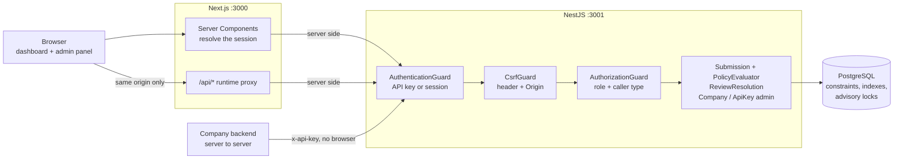

**Where tenant identity comes from.** Never the request body. An API key
resolves to exactly one company; a session resolves to one person, who belongs
to one company - or, for the platform administrator, to none: `companyId` is
`null` by construction, so `tenantScope()` throws for them rather than quietly
returning everything.

**Why the proxy exists.** So the browser only ever addresses one origin. That
keeps the session cookie first-party, which is what makes `SameSite=Lax`
meaningful, and it means there is no CORS configuration anywhere to get wrong.
**It is not a security firewall:** it forwards whatever it is given, and every
rule is enforced by the API behind it. The whole authorization matrix was
measured with the UI bypassed - see
[`docs/security/endpoint-authorization.md`](docs/security/endpoint-authorization.md).

**Where the business invariants live.** In the database, not in application
checks: a unique constraint for idempotency, a conditional `UPDATE` for review
resolution, a transaction-scoped advisory lock for frequency counting. Each has
a negative control proving the failure reappears without it.

---

## Quick start

### Requirements

- Docker and Docker Compose
- Node.js **>= 22.12** - only if you want to run the tests or linters outside Docker

### One command

```bash
cp .env.example .env
```

```bash
docker compose up
```

That starts PostgreSQL, applies the migrations, seeds the data, and starts the
API and the web application. No second command is needed.

| Service | URL |
|---|---|
| Web | <http://localhost:3000> |
| API | <http://localhost:3001> |
| Health | <http://localhost:3001/health> |
| PostgreSQL | `localhost:5433` - 5433, so it cannot collide with a local install |

**You know it is ready when** all three containers report `healthy`
(`docker compose ps`) and the API log shows `[entrypoint] seed complete`
followed by the seed banner naming the development credentials.

```bash
curl http://localhost:3001/health
```

```json
{ "status": "ok", "uptimeSeconds": 12, "checks": { "database": { "status": "up", "latencyMs": 2.57 } } }
```

A `503` with `"status": "degraded"` means the API is running and PostgreSQL is
not.

> **Open `http://localhost:3000`, not `http://127.0.0.1:3000`.** The API
> compares the browser's `Origin` header against `APP_ORIGIN` **exactly**, and
> the two spellings are different strings - the wrong one gives `403` on login
> with no explanation. To use a different host or port, change `APP_ORIGIN` in
> `.env` to match (risk R-34).

### Stopping

```bash
docker compose down
```

```bash
docker compose down -v
```

The second one also discards the database volume. **Every expense, review and
key you created is gone** and the next start seeds from scratch. Use the first
one to keep your data.

### Environment

Everything is in `.env.example`, which you copy to `.env`. Nothing else reads
`process.env`: `apps/api/src/config/env.schema.ts` validates the whole set with
Zod, and the process refuses to start if anything is missing or malformed -
naming the offending variables without printing their values.

| Variable | Default | Notes |
|---|---|---|
| `WEB_PORT`, `API_PORT`, `DB_PORT` | 3000, 3001, 5433 | Host ports, all bound to `127.0.0.1` |
| `APP_ORIGIN` | `http://localhost:3000` | Must match the origin your browser shows |
| `DATABASE_URL` | the compose database | |
| `SESSION_TTL_HOURS` | 8 | Enforced in SQL, not only in the cookie |
| `COOKIE_SECURE` | `true` | `true` in every environment; browsers treat `localhost` as secure |
| `BCRYPT_COST` | 10 | Passwords only |
| `DB_POOL_MAX` | 10 | Must stay above any concurrency a test uses (risk R-10) |
| `SEED_DEV_DATA` | `true` in compose | The seed **refuses** to run under `NODE_ENV=production` without it |

---

## Demo accounts and credentials

Published here on purpose so the stack is runnable, used nowhere else, and
**development-only**. Only hashes reach the database - bcrypt for passwords,
SHA-256 for API keys. They are deliberately **not** shown on the sign-in page.

| Role | Email | Password |
|---|---|---|
| Manager, Nile Logistics | `manager@nile-logistics.test` | `NileManager!2026` |
| Manager, Delta Consulting | `manager@delta-consulting.test` | `DeltaManager!2026` |
| Platform administrator | `admin@limaz.test` | `PlatformAdmin!2026` |

| Company | API key, sent as `x-api-key` |
|---|---|
| Nile Logistics | `lmz_dev_nile_7Qk2PmXaR4tVbN8cLw3ZyH6dJeF5uG9s` |
| Delta Consulting | `lmz_dev_delta_3Xn9TbVcA7pKmR2wQy8ZsL4dHe6uJ5g` |

Every account above was signed in with, and both keys authenticated, on a
**clean-clone installation** during final verification.

### Seeded data

| | Nile Logistics | Delta Consulting |
|---|---|---|
| Auto-approve limit | 500.00 SAR | 2,000.00 SAR |
| Frequency rule | more than 3 in 60 minutes | more than 5 in 30 minutes |
| Blocked categories | `GAMBLING` | `ALCOHOL`, `GAMBLING` |

Plus 12 expenses covering all three decisions, 7 rule hits and 3 reviews (one
open, one approved by a manager, one rejected). The data demonstrates the rules
rather than filling the screen: it includes an expense where two rules fire and
`REJECT` beats `REVIEW`, and **the same `externalId` in both companies**, which
is what tenant-scoped uniqueness means.

The seed is idempotent - every write is an upsert on a fixed id - so the
container seeds on every start without the data doubling. It verifies its own
work by counting **its own** rows, so expenses you create do not stop the stack
restarting.

### Creating a manager for a company you created yourself

**In the application.** Open the company in the admin workspace and use the
**Managers** panel: *Add manager*, then a name, an email and an initial
password of at least 12 characters.

Creating a company still makes its policy and first API key but **not** a
manager (assumption A5) - a company's first manager is a separate, deliberate
act rather than a side effect. What changed in F11 is that it is now an act
you can perform, instead of a database row you had to write yourself.

Three things the panel does not pretend to do, and says so:

- **nothing is emailed.** You choose the initial password and hand it over
  yourself. The API never returns it.
- **there is no reset.** A manager cannot change their password in the
  application, and neither can you (risk R-36).
- **accounts cannot be removed.** A resolved review names its reviewer, and
  `onDelete: Restrict` means the database refuses to orphan that record.

The same thing over the API, if you prefer:

```bash
curl -s -X POST http://localhost:3001/v1/admin/companies/<companyId>/managers \
  -H 'content-type: application/json' -H 'x-limaz-client: 1' \
  -b cookies.txt \
  -d '{"displayName":"Test Manager","email":"you@example.test","password":"ChooseYourOwn!2026"}'
```

`201` with the new manager's id, email and role - and **no credential**.

---

## Five-minute walkthrough

A real path through the running application. Steps 1-8 are the ones worth your
time; everything after is there if you want it.

**1. Start it and sign in.** `docker compose up`, then
<http://localhost:3000> as `manager@nile-logistics.test`. You land on the
company overview: totals by current status, read from one aggregate query, so
they come from one database snapshot and add up.

**2. Submit an expense the policy flags.** Nile's limit is 500.00 SAR, so
888.00 is over it:

```bash
curl -s -X POST http://localhost:3001/v1/expenses -H 'x-api-key: lmz_dev_nile_7Qk2PmXaR4tVbN8cLw3ZyH6dJeF5uG9s' -H 'content-type: application/json' -d '{"externalId":"demo-1","employeeId":"emp-7","amount":88800,"currency":"SAR","merchant":"Grand Hotel","category":"TRAVEL","spentAt":"2026-11-21T09:00:00.000Z"}'
```

`201`, `"decision":"REVIEW"`, and a `reasons` array naming `AMOUNT_LIMIT` with
the limit it was judged against. `amount` is in **minor units**: 88800 is
888.00 SAR.

**3. Retry it, byte for byte.** The same command again returns `200`,
`"duplicate": true`, and **the same decision**. No second expense exists. Now
change `amount` to `99900` and keep `externalId`: `409`. A different expense
wearing a used identifier is a client bug, and hiding it would be worse than
reporting it.

**4. Resolve it in the dashboard.** Reload the browser: **Reviews** has a new
row. Open it - every rule that fired is there with its evidence, and the policy
snapshot the expense was judged against. Approve it behind the confirmation
that names the merchant and the amount.

**5. Look at what changed.** The expense now reads `Policy: Review` **and**
`Approved`. Those are two different facts: what the policy decided, which never
changes, and the final status, which a human set. The dashboard counts move
with it.

**6. Change the policy and watch history hold still.** **Policy** → raise the
auto-approve limit to 2,000.00 and save. Submit a new expense for 888.00: now
`APPROVE`. Re-run step 3's retry: it still replays `REVIEW`, because that
expense was judged against the policy of its own moment.

**7. Try to cross the tenant line.** Copy the expense id from the URL, sign
out, sign in as `manager@delta-consulting.test`, and open the same URL.
**404** - not 403, which would confirm the record exists.

**8. Be the platform administrator.** Sign in as `admin@limaz.test`. Both
companies are listed with how many of their keys can authenticate right now.
**Add a company** writes the company, its policy and its first key in one
transaction and shows the raw key **once**. Copy it, submit an expense with it,
and the policy created in that same transaction is what decides it. Rotate the
key: both work, because the old one gets a 24-hour grace window. Revoke one: it
stops immediately.

**Further, if you want it:** the per-feature manual cycles in
[`docs/testing/`](docs/testing/) walk the same ground in more detail -
including forcing a concurrent resolution conflict with two independent
sessions, and the key lifecycle end to end.

---

## API usage

Versioned under `/v1`. Company backends call it directly on `:3001`; the
browser goes through the same-origin proxy on `:3000`.

### Submit an expense

```bash
curl -i -X POST http://localhost:3001/v1/expenses -H 'x-api-key: lmz_dev_nile_7Qk2PmXaR4tVbN8cLw3ZyH6dJeF5uG9s' -H 'content-type: application/json' -d '{"externalId":"exp-1001","employeeId":"emp-7","amount":12500,"currency":"SAR","merchant":"City Taxi","category":"TRANSPORT","spentAt":"2026-11-20T09:15:00.000Z"}'
```

| Field | Rule |
|---|---|
| `externalId` | your identifier; **unique per company** |
| `employeeId` | compared exactly - normalising it would merge two employees |
| `amount` | **integer minor units**. `12500` is 125.00 SAR. A decimal is rejected |
| `currency` | ISO-4217, and it must match the company's currency |
| `category` | normalised (trimmed, upper-cased) on both sides of the blocked-list comparison |
| `spentAt` | ISO-8601, within 5 minutes of the future and 90 days of the past |

A body carrying `companyId` is rejected `400`: the DTO is `.strict()`, so the
tenant is not something a caller gets to mention.

PowerShell:

```powershell
curl.exe -i -X POST http://localhost:3001/v1/expenses -H 'x-api-key: lmz_dev_nile_7Qk2PmXaR4tVbN8cLw3ZyH6dJeF5uG9s' -H 'content-type: application/json' -d '{\"externalId\":\"exp-1001\",\"employeeId\":\"emp-7\",\"amount\":12500,\"currency\":\"SAR\",\"merchant\":\"City Taxi\",\"category\":\"TRANSPORT\",\"spentAt\":\"2026-11-20T09:15:00.000Z\"}'
```

### Idempotent retry

Send **exactly the same body**. Do not recompute `spentAt` between the two
calls, or it is a different expense and you will get `409` instead.

```
201  first time        { "decision": "...", "duplicate": false }
200  identical retry   { "decision": "<the original>", "duplicate": true }
```

The decision is replayed from the stored row. The evaluator is not called
again, so a retry cannot count toward the frequency rule a second time.

### Conflicting retry

Same `externalId`, different business payload:

```
409  { "error": "idempotency_conflict", ... }
```

### Trigger each decision

```bash
curl -s -X POST http://localhost:3001/v1/expenses -H 'x-api-key: lmz_dev_nile_7Qk2PmXaR4tVbN8cLw3ZyH6dJeF5uG9s' -H 'content-type: application/json' -d '{"externalId":"demo-approve","employeeId":"emp-1","amount":12500,"currency":"SAR","merchant":"City Taxi","category":"TRANSPORT","spentAt":"2026-11-21T08:00:00.000Z"}'
```

```bash
curl -s -X POST http://localhost:3001/v1/expenses -H 'x-api-key: lmz_dev_nile_7Qk2PmXaR4tVbN8cLw3ZyH6dJeF5uG9s' -H 'content-type: application/json' -d '{"externalId":"demo-review","employeeId":"emp-2","amount":99900,"currency":"SAR","merchant":"Grand Hotel","category":"TRAVEL","spentAt":"2026-11-21T08:00:00.000Z"}'
```

```bash
curl -s -X POST http://localhost:3001/v1/expenses -H 'x-api-key: lmz_dev_nile_7Qk2PmXaR4tVbN8cLw3ZyH6dJeF5uG9s' -H 'content-type: application/json' -d '{"externalId":"demo-reject","employeeId":"emp-3","amount":1000,"currency":"SAR","merchant":"Casino","category":"gambling","spentAt":"2026-11-21T08:00:00.000Z"}'
```

`APPROVE`, `REVIEW`, `REJECT`. The third sends `gambling` in lower case on
purpose: both sides of the comparison go through the same normaliser. A final
`REJECT` opens **no** review - there is nothing for a human to decide.

For the frequency rule, send four expenses for one `employeeId` with `spentAt`
values inside one hour: the fourth returns `REVIEW` with reason `FREQUENCY`.

### Human endpoints

These need a **session**, not a key, plus an `x-limaz-client` header on
anything state-changing:

```bash
curl -s -c /tmp/limaz.jar -X POST http://localhost:3000/api/v1/auth/login -H 'content-type: application/json' -H 'x-limaz-client: 1' -H 'origin: http://localhost:3000' -d '{"email":"manager@nile-logistics.test","password":"NileManager!2026"}'
```

```bash
curl -s -b /tmp/limaz.jar 'http://localhost:3000/api/v1/reviews?state=OPEN' -H 'x-limaz-client: 1'
```

```bash
curl -s -b /tmp/limaz.jar -X POST http://localhost:3000/api/v1/reviews/REVIEW_ID/resolve -H 'content-type: application/json' -H 'x-limaz-client: 1' -H 'origin: http://localhost:3000' -d '{"decision":"APPROVE"}'
```

`200` sets the expense's final status. A second resolve returns `409` naming
who resolved it and when. The body is `.strict()`, so sending
`resolvedByUserId` is a `400`: the reviewer is the authenticated manager and
nothing else.

```bash
curl -s -b /tmp/limaz.jar -X PATCH http://localhost:3000/api/v1/policy -H 'content-type: application/json' -H 'x-limaz-client: 1' -H 'origin: http://localhost:3000' -d '{"autoApproveLimitMinor":200000}'
```

Policy changes apply to **new** evaluations only.

### Administration

Sign in as the platform administrator, then:

| | |
|---|---|
| `GET /v1/admin/companies` | every company, with how many keys can authenticate **right now** |
| `POST /v1/admin/companies` | company + policy + first key, one transaction. The raw key is in the response, once |
| `POST /v1/admin/companies/:id/api-keys` | issue another |
| `POST /v1/admin/companies/:id/api-keys/:keyId/rotate` | new key active immediately, old one expires in 24 hours |
| `POST /v1/admin/companies/:id/api-keys/:keyId/revoke` | stops immediately, no grace |

**Handling the secret.** It is shown once because only its SHA-256 hash is
stored, so it cannot be recovered through any API - not by an administrator,
not by reading the database. If a response is lost, the recovery is: refresh
the key list, identify the newest `ACTIVE` key nobody holds the value of,
revoke it, and issue a replacement deliberately. Key mutations never retry
automatically, so an ambiguous network failure cannot mint a second credential
by itself (risk R-33).

---

## Business rules

The exact implemented semantics.

| Rule | Fires when | Decision |
|---|---|---|
| Amount limit | the amount is **strictly above** the company's auto-approve limit | `REVIEW` |
| Frequency | the same employee has **more than** `frequencyMaxCount` expenses inside `frequencyWindowMinutes` | `REVIEW` |
| Blocked category | the normalised category is on the company's blocked list | `REJECT` |

- **The boundary is tested at all three points.** With a 500.00 limit: 49,999
  approves, 50,000 approves, 50,001 reviews.
- **The current expense counts, exactly once.** The window is
  `[spentAt - window, spentAt]`, inclusive at both ends, and the count is taken
  *before* the row is inserted - so the fourth expense of four fires a "more
  than 3" rule (assumption A1).
- **Rejected expenses still count** toward frequency. The rule measures
  behaviour, not approvals; otherwise an employee could reset their own window
  by submitting something that gets rejected (assumption A2).
- **Scoped to the company and the employee**, never across either.
- **Category matching is normalised on both sides** by the same function, so
  `gambling`, `Gambling` and ` GAMBLING ` are one category. Risk R-17 records
  what normalisation does *not* catch: a typo is simply a different category.
- **Strongest decision wins:** `REJECT > REVIEW > APPROVE`, over an explicit
  rank table, tested across all six orderings.
- **Every rule that fired is kept and returned** - no short-circuit. An expense
  can carry both `AMOUNT_LIMIT` and `BLOCKED_CATEGORY` and report both while
  `REJECT` wins.
- **A `REVIEW` decision opens exactly one review.** A final `REJECT` opens
  none.
- **Each expense stores the policy snapshot it was judged against.** Editing
  the policy today changes nothing about yesterday's decision, its rule hits,
  its snapshot or its human resolution.
- **`decision` and `status` are different columns.** `decision` is what the
  policy said and is never rewritten; `status` is the outcome, which a manager
  can set. `Policy: Review` + `Approved` is a normal, meaningful pair.

### The accepted out-of-order limitation

Decisions are never recalculated, and the frequency window looks only
**backwards**. So a late arrival can evade the rule:

> An employee submits expenses spent at 10:00, 10:10 and 10:20 - all
> `APPROVE`, each seeing at most 3 in its window. A fourth, **spent at
> 10:05**, arrives at 10:30. Its own window `[09:05, 10:05]` contains only the
> 10:00 expense, so it counts 2 and is approved. Four expenses now exist inside
> one hour and none of them ever saw four.

Re-evaluating the three earlier expenses would mean changing decisions already
sent to a client, which is a worse property than this gap. Recorded as **risk
R-11**, with the sliding sub-window upgrade path in ADR-002.

---

## Database model

Eight tables. The full ERD and the reasoning behind each constraint are in
[`docs/architecture/data-model.md`](docs/architecture/data-model.md).

| Table | Why it looks like that |
|---|---|
| `companies` | the tenant root |
| `policies` | `companyId` is **unique** - one policy per company, enforced by the database rather than by convention |
| `users` | manager or platform admin; the admin's `companyId` is `NULL` |
| `sessions` | SHA-256 of an opaque token, with an absolute expiry checked in SQL |
| `api_keys` | SHA-256 in a **unique** column, plus a 16-character prefix for display, with status, `expiresAt` and `revokedAt` |
| `expenses` | `UNIQUE (companyId, externalId)` - idempotency is a constraint, not a check. Also `UNIQUE (id, companyId)`, which exists only so a review can point at it compositely |
| `rule_hits` | one row per rule that fired, `UNIQUE (expenseId, ruleCode)` |
| `reviews` | `UNIQUE expenseId`, and a **composite foreign key** `(expenseId, companyId) → expenses(id, companyId)`, so a review whose tenant differs from its expense's is physically unstorable (ADR-011) |

Five hand-written `CHECK` constraints enforce the state machine - for example
`reviews_state_resolution_check`, which makes "resolved with no outcome" and
"open with a resolver" both unrepresentable.

Indexes exist for measured reasons: `(companyId, employeeId, spentAt)` for the
frequency count, `(companyId, spentAt)` for the listing, `(companyId, state)`
for the review queue.

---

## Concurrency

Three different problems, three different database mechanisms. They are not
interchangeable, and reaching for the wrong one is a real failure rather than a
style choice.

### 1. Duplicate expenses - a unique constraint

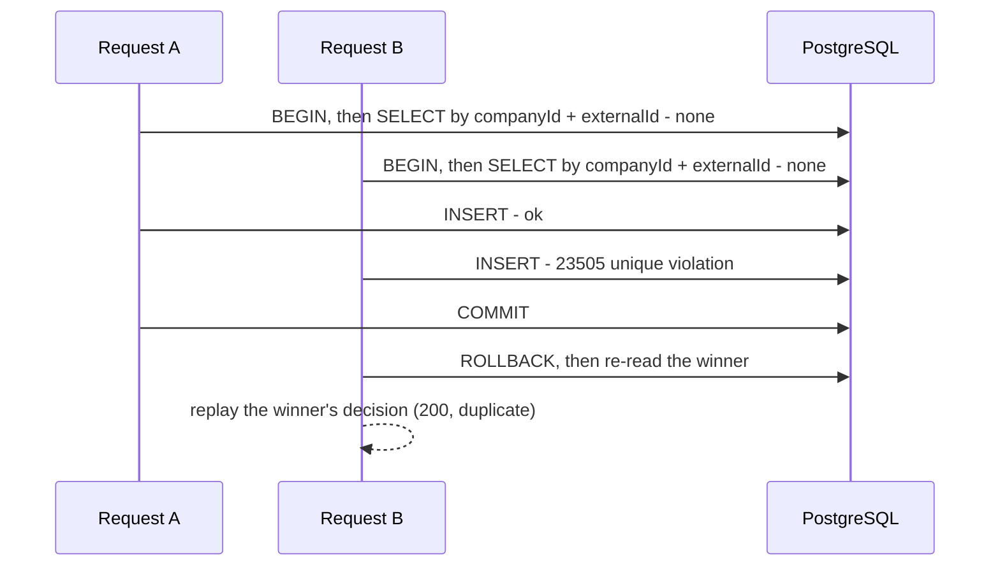

The check-then-insert race is unavoidable; the constraint is what makes losing
it safe. The loser's transaction is **aborted**, so it must re-read on a fresh
one - a real bug this project hit and fixed (AI_LOG 20).

**Negative control:** drop the unique index and the duplicate appears.

### 2. Frequency bypass - a transaction-scoped advisory lock

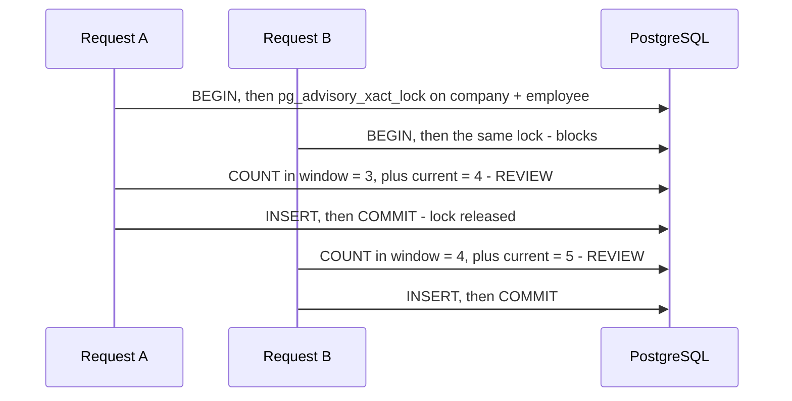

A row lock cannot help here: the invariant is a **COUNT across many rows** and
there is no single row to lock. Under `READ COMMITTED` two transactions would
both read `3` and both approve. The lock is keyed on
`(companyId, employeeId)`, so unrelated traffic never contends.

**Negative control:** remove the lock and five simultaneous submissions produce
five approvals instead of three.

### 3. Double resolution - one conditional UPDATE

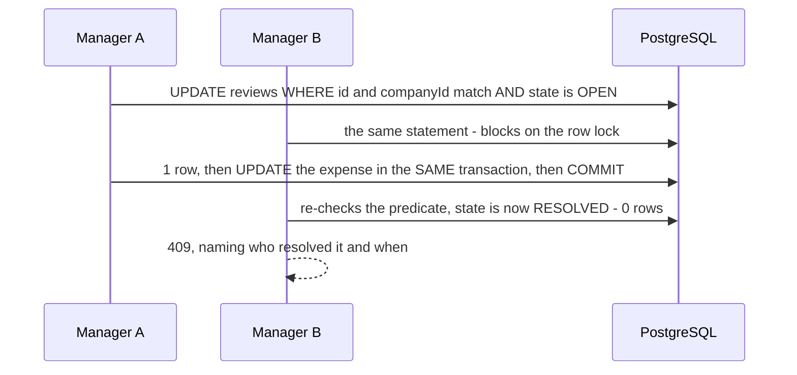

The tenant predicate and the concurrency predicate sit in the same `WHERE`, so
there is no window between "is it mine?" and "is it still open?". Review and
expense move in one transaction, so no observer ever sees one updated without
the other.

**Negative control:** remove `AND state = 'OPEN'` and the second resolution
silently overwrites the first.

### What this does *not* claim

- A transaction alone does not prevent a lost update. `READ COMMITTED` lets two
  transactions read the same value and both write; what prevents it is the
  **predicate**, re-checked under the row lock.
- A `200` is not proof of a state transition. An idempotent replay also returns
  `200` and changes nothing - which is why the tests assert the **database
  state**, not only the status code.
- API key mutations are a separate case. Rotation is one row changing state, so
  it uses a conditional update rather than a lock; issuance is **not**
  idempotent at all (risk R-33).

---

## The eight decisions

The assessment leaves these open on purpose. Full reasoning, the alternatives
rejected and the test strategy are in [`docs/adr/`](docs/adr/); the answers
themselves are here.

**1. The same `externalId` arrives again with a different body. What do you
return?**

`409 Conflict`. A `payloadHash` over the canonicalised business fields
distinguishes a genuine retry - which replays the original decision with `200`
and `duplicate: true` - from a conflicting resubmission.

The two rejected alternatives both destroy something. Returning the original
silently hides a real client bug: two different expenses are now one, and
nobody is told. Updating the stored expense destroys idempotency, because the
answer to a request then depends on how many times it was sent.

*Trade-off:* a client that legitimately needs to correct an expense has no path
except a new `externalId`. *Limitation:* the canonicalisation is a public
contract with no version field (risk R-26).
[ADR-001](docs/adr/ADR-001-idempotency-conflicting-payload.md)

**2. Does the frequency window use `spentAt` or receipt time? Does the current
expense count?**

`spentAt`, window `[spentAt - 60min, spentAt]` inclusive at both ends, and
**yes** - the current expense counts, so the fourth fires a "more than 3" rule.

`spentAt` measures employee behaviour; receipt time measures network
conditions. A client queue that stalls and flushes ten expenses at once would
place all ten in one window and fire the rule on behaviour that never happened.

*Trade-off:* `spentAt` is client-supplied, so it is bounded (5 minutes future,
90 days past) rather than trusted. *Limitation:* decisions are never
recalculated and the window looks only backwards, so a back-dated expense can
evade the rule - risk R-11, with a worked example above.
[ADR-002](docs/adr/ADR-002-frequency-window.md)

**3. A company asks for another company's record by id. What do you answer, and
why?**

`404 Not Found`, never `403`. `403` confirms the record exists, which turns the
endpoint into an enumeration oracle: a caller could walk ids and learn how many
expenses a competitor has.

Enforcement is structural rather than a branch: every query carries
`WHERE companyId = <authenticated>`, so the row is never loaded and "not yours"
and "not there" are genuinely the same code path. F06-NC1 is the negative
control - remove the predicate and the whole table comes back with nothing
erroring.

*Trade-off:* a legitimate user who mistypes an id gets the same message as an
attacker. *Limitation:* nothing structurally prevents a future query from
omitting the predicate (risk R-20).
[ADR-003](docs/adr/ADR-003-cross-tenant-response.md)

**4. Can a review be resolved twice? What is the expense's final status after
it is resolved?**

No. One conditional
`UPDATE ... WHERE id = ? AND companyId = ? AND state = 'OPEN'`, with the review
and the expense updated in the **same transaction**, so there is no observable
moment where one has moved and the other has not. The loser gets `409` naming
who resolved it and when.

`decision` (what the policy said) and `status` (the outcome) are separate
columns. Resolving changes only `status`, so an expense can read
`Policy: Review` and `Approved` at once - and that is the point, not a
contradiction.

*Trade-off:* the loser's work is discarded rather than queued. *Limitation:*
revocation of a decision does not exist - there is no "unresolve".
[ADR-004](docs/adr/ADR-004-review-resolution.md)

**5. How do you represent money amounts?**

Integer minor units plus an ISO-4217 currency code: `12500` with `SAR` is
125.00 SAR.

Floating point loses money - `0.1 + 0.2 !== 0.3`, and `Math.round(1.005 * 100)`
gives 100 when the answer is 101. Integers keep every operation in native
integer space in both PostgreSQL and JavaScript and make the wire format
unambiguous. The frontend converts with **string arithmetic**, never
multiplication.

*Trade-off:* every caller must know the exponent. *Limitation:* `int4` caps a
single expense at about 21.4 million major units (risk R-25).
[ADR-005](docs/adr/ADR-005-money-representation.md)

**6. How do you store API keys, and what does rotating one look like?**

SHA-256 hash only, in a unique column, with a 16-character prefix kept for
display. The plaintext is generated from 32 CSPRNG bytes and shown exactly
once.

SHA-256 rather than bcrypt because the key already has 256 bits of entropy, so
a slow hash buys nothing - and bcrypt's per-row salt makes the lookup
unindexable, turning every authenticated request into a full table scan.

Rotation issues a new key, active immediately, and moves the old one to a
**24-hour grace window** - without it every rotation is an outage, because a
company cannot deploy a new key to all its servers atomically. Revocation is
immediate, because the reason you revoke is that it leaked. Only an `ACTIVE`
key may be rotated: rotating one already in grace would push its expiry out
again, forever.

Every lifecycle condition lives in the authentication query's `WHERE` clause,
so no code path can forget one.

*Trade-off:* a lost key cannot be recovered, only replaced. *Limitation:*
issuance is not idempotent (risk R-33).
[ADR-006](docs/adr/ADR-006-api-key-storage-rotation.md)

**7. Where does the frequency count live, and what happens at 1,000 expenses
per second?**

A `COUNT(*)` over `(companyId, employeeId, spentAt)` inside the submission's
own transaction, serialised by
`pg_advisory_xact_lock(hashtext(companyId), hashtext(employeeId))`.

**This is a different guarantee from idempotency,** and that is the heart of
the answer. The unique constraint stops duplicate rows; it does nothing about
two transactions both reading `count = 3` and both deciding the rule does not
fire. The lock is keyed per employee, so unrelated traffic never contends.

At 1,000 eps: see [the scaling section](#at-1000-expenses-per-second) for the
measured query plans and the ordered list of bottlenecks. Short version -
transaction throughput first, then per-employee lock contention (which depends
on the workload's shape, not its rate), then partitioning. A counter in Redis
comes last and trades exactness for throughput.
[ADR-007](docs/adr/ADR-007-frequency-concurrency.md)

**8. Where does the browser keep the login session, and why?**

A server-side session row, referenced by an opaque token in an `HttpOnly`,
`Secure`, `SameSite=Lax` cookie. Only the SHA-256 hash of the token is stored.

Not `localStorage`, which any XSS can read. Not a stateless JWT, because a JWT
cannot be revoked and this system needs revocation for logout, session expiry
and removing access. The expiry is checked **in SQL**, so a stolen cookie
cannot outlive its row.

The cookie is first-party because the browser only ever addresses the web
origin and Next proxies `/api/*` server-side. That is what makes `SameSite=Lax`
a real CSRF control, and it is why there is no CORS configuration anywhere.

*Trade-off:* a database read on every authenticated request - one indexed
lookup. *Limitation:* `HttpOnly` stops a script reading the token, not using
the session (risk R-18).
[ADR-008](docs/adr/ADR-008-browser-session.md)

---

## Security

| Control | What it does | What it does **not** do |
|---|---|---|
| API key authentication | SHA-256 lookup in a unique column; status, expiry and revocation are **in the `WHERE` clause**, so a revoked key cannot be returned at all | Does not give a key a role. `@Roles` implies a human caller, so a key is refused every management route |
| Session authentication | Opaque token, SHA-256 at rest, absolute expiry checked in SQL | Not a JWT: this system needs revocation, and a JWT cannot be revoked |
| Cookie | `HttpOnly`, `Secure`, `SameSite=Lax`, first-party because of the same-origin proxy | `HttpOnly` stops a script *reading* the token; it does not stop a script *using* the session (risk R-18) |
| CSRF | Four layers: `SameSite=Lax`, **no CORS at all**, a required `x-limaz-client` header, and a server-side `Origin` check | CORS is permission a server *grants*; its absence is the strict posture. It is **not** an authorization mechanism |
| Role authorization | `@Roles` on the controller class, so a route added later inherits it | Frontend route guards are presentation. Every refusal in this repository was measured with the UI bypassed |
| Tenant isolation | `companyId` from the credential only, inside every query's `WHERE`; `404` not `403` for another company's id | Not enforced by anything that would stop a future query omitting it (risk R-20) |
| Database constraints | Unique indexes, CHECK constraints and a composite foreign key make several invalid states unstorable | They do not validate business input - that is Zod, at the boundary |
| Error sanitisation | 5xx bodies carry no internals; the redactor scrubs credentials by header name, key name and pattern before any log write | The redactor is a **backstop with named gaps** (risk R-22). Credentials travel in headers, never in URLs |
| Frontend cache | `QueryProvider` is keyed by `user.id`, so a different user mounts a new client with no cache to read | |
| Server Component authorization | Each page checks the role **before** fetching, so an unauthorized page contributes nothing to the RSC payload | A layout that hides its children does **not** stop them rendering - that mistake and its fix are AI_LOG 44 and 47 |

Things this project does **not** claim: the proxy is not SQL-injection
protection (parameterised queries are - there is no string-built SQL anywhere);
route guards do not replace backend authorization; and "no CORS configuration"
means the browser's deny-by-default applies, not that cross-origin access is
authorized somewhere else.

**For a real deployment:** terminate TLS at the load balancer, inject
`DATABASE_URL` from a secret manager, never set `SEED_DEV_DATA`, and retire the
seeded development credentials - they are published in this repository.

---

## Testing

```bash
docker compose up -d db
```

```bash
npm ci
```

```bash
npm test
```

```
@limaz/api   Test Suites: 34 passed, 34 total      Tests: 487 passed
@limaz/web   Test Suites:  2 passed,  2 total      Tests:  30 passed
```

| Command | What it covers |
|---|---|
| `npm test --workspace @limaz/api` | 487 tests against **real PostgreSQL** |
| `npm test --workspace @limaz/web` | 30 tests over the two pure frontend modules |
| `TZ=America/New_York npm test --workspace @limaz/web` | proves the display timezone is fixed rather than inherited |
| `npm run lint`, `npm run typecheck`, `npm run build` | static gates |
| `npm run verify` | all three, both workspaces |
| `node scripts/check-contrast.mjs` | prints all 15 design-token contrast ratios |
| `bash scripts/verify-f00.sh` … `verify-f02-1.sh` | acceptance against a **rebuilt** Docker stack |

### The safe order

Several of these drive the same throwaway database (`limaz_test`), and each
acceptance script runs the Jest suite internally. **Run them one at a time:**

```bash
docker compose up -d --build && docker compose ps
```

```bash
npm run verify
```

```bash
npm test
```

```bash
bash scripts/verify-f00.sh && bash scripts/verify-f01.sh && bash scripts/verify-f02.sh && bash scripts/verify-f02-1.sh
```

A session-level PostgreSQL advisory lock enforces this: a second run refuses to
start and prints the pid holding the lock. Full reasoning in
[`docs/testing/verification-order.md`](docs/testing/verification-order.md).
`verify-f02.sh` and `verify-f02-1.sh` destroy and rebuild the **development**
volume, so do not run them with data you want to keep.

### What kind of test is what

| Kind | Where | Note |
|---|---|---|
| Unit | beside the code | pure functions: rules, canonicalisation, money, key generation |
| Integration / e2e | `apps/api/test/` | real PostgreSQL, real HTTP, **no mocked repositories** - a mock cannot raise `23505`, abort a transaction or serialise on an advisory lock |
| Concurrency | `concurrency`, `policy-concurrency`, `api-key-lifecycle` | genuinely overlapping requests, bounded by the connection pool rather than by the test runner |
| **Negative controls** | `negative-control`, `review-negative-control`, `dashboard-negative-control` | remove the mechanism, watch the failure appear. They refuse to run unless `current_database()` is `limaz_test` |
| Browser | recorded as `PASS (browser)` | with the measured value or the screenshot that shows it |
| Manual | `docs/testing/*-manual-cycle.md` | step by step against the real stack |

**Component *behaviour* has no automated runner** (risk R-23). Nothing in this
repository claims an automated DOM test that does not exist: browser-verified
rows say so, every time.

---

## Deployment and scaling

The compose file is the review artefact. It runs in Docker; it is **not** a
cloud deployment, and nothing here has been deployed to one.

| Concern | Approach |
|---|---|
| Database | Managed PostgreSQL (RDS, Cloud SQL, Neon) with automated backups and point-in-time recovery. Never a container |
| Connection pooling | PgBouncer in **transaction** mode. `pg_advisory_xact_lock` is transaction-scoped and therefore compatible; a session-scoped lock would not be |
| API and web | Both images behind one hostname, `/api/*` routed to the API - same-origin in production exactly as in development, so cookie behaviour does not change between environments |
| Migrations | A **pre-deploy job**, not the container entrypoint, so N replicas do not race. The entrypoint used here is right for a one-command review environment and wrong for production |
| Image | Prune devDependencies once migrations move out of the entrypoint. Today the runtime image keeps the whole tree because it needs the Prisma CLI (risk R-30) |
| Secrets | Injected by the platform's secret manager. No `.env` in any image - asserted by F00-T12 |
| TLS | Terminated at the load balancer; `Secure` cookies then behave identically to development |
| Scaling | The API is stateless - sessions live in PostgreSQL, not in memory - so it scales horizontally. The advisory lock is **in the database**, so it keeps working across replicas, which a process-local mutex would not |
| Observability | Structured JSON logs with a correlation id, through the existing redaction interceptor |
| Health | `/health` already reports database reachability and latency; point the load balancer at it |

### At 1,000 expenses per second

**What is guaranteed today:** correctness under concurrency, proven against
real PostgreSQL with negative controls. **What is not:** that throughput, which
has never been measured on anything but a laptop.

A local smoke test - one container, concurrency 10, 1,200 requests, 0 errors -
measured `POST /v1/expenses` at **p50 59 ms, ~161 req/s** and the API-key
lookup at **p50 15 ms, ~580 req/s**. That is a sanity check, not a capacity
number.

The likely bottlenecks, in the order they would bite:

1. **Transaction throughput and connection count.** Every submission is one
   transaction holding an advisory lock. Pool first, PgBouncer second.
2. **Lock contention - but only per employee.** 1,000 eps spread across many
   employees barely contends; 1,000 eps for *one* employee serialises
   completely. The shape of the workload matters more than the rate.
3. **The frequency `COUNT`.** Measured at 4,212 rows it is an **index-only
   scan**: 5 buffer hits, 0.046 ms. It grows with rows *in the window*, not
   with table size, so the index keeps it flat until the table itself wants
   partitioning by month.
4. **The dashboard aggregate.** One `HashAggregate` over the company's
   expenses: 1.47 ms at 4,212 rows, and linear. This is the first read that
   would need a covering index or a maintained counter.

How it should be measured: a load generator against a deployed stack with a
realistic employee distribution, reporting p50/p95/p99 and error rate at a
fixed arrival rate - not a request loop on a developer machine.

Only after a measured problem would a Redis counter be worth it, and it trades
exactness for throughput: the advisory lock gives an exact count, Redis gives a
fast approximate one.

---

## Known limitations

Every one is real, deliberate and recorded in [`docs/risks.md`](docs/risks.md).
None is a mandatory requirement of the assessment.

| | Limitation | Why it exists | Impact | What would fix it |
|---|---|---|---|---|
| R-11 | A back-dated expense can evade the frequency rule | Decisions are never recalculated; recalculating would change answers already given to a client | A gap in the rule, not a wrong answer | Sliding sub-window evaluation (ADR-002) |
| R-23 | No automated DOM/interaction tests | None of the four core guarantees is provable in a browser; the time went to tests that do prove them | Frontend regressions need a human | A Playwright suite |
| R-28 | Keyset pagination has no backward cursor | A true backward keyset needs a second ordering and a second query path | "Older" walks a client-held trail; a reload loses it | Bidirectional cursors |
| R-30 | 3 high + 19 moderate `npm audit` findings | All in dev tooling. The vulnerable `effect` symbol is not even present in the package that imports it; npm would not apply an override, and its only offered fix is a major downgrade | None measured on any request path | A Prisma release off the pinned `effect` |
| R-31 | Concurrent policy edits are last-write-wins | The assessment requires conflict handling for **reviews**, not for policy edits; a version column would be machinery for a race nobody has | A silently reverted setting | An `updatedAt` precondition |
| R-36 | A manager’s password cannot be changed or reset in the application | A reset path needs email delivery, or a route that overwrites a credential. Neither is in scope | An account keeps the password it was created with | Administrator-set replacement, or an invitation flow |
| R-33 | API key issuance is not idempotent | The caller is a human in a browser, and the orphan key is visible in the list | A credential nobody tracks | An idempotency key |
| R-34 | The `Origin` check refuses a different spelling of the same host | Exact comparison is what makes the layer worth having | A confusing `403` | Documented in the quick start |
| - | No load testing; no screen-reader or WCAG conformance audit | Out of scope; stated rather than implied | Claims are limited accordingly | |

## With more time

1. **The optional card webhook** (section 10). Per-company HMAC-SHA256 over the
   raw body, tenant resolution without trusting the payload, a unique
   constraint on `transactionId` for exactly-once expense creation, and
   asynchronous processing. Queue-down behaviour and finding events the
   provider never delivered need designing, not just coding.
2. **Close R-11** with sliding sub-window evaluation.
3. **Rate limiting** on login and per API key, plus a Content-Security-Policy
   (risks R-19, R-18).
4. **A browser end-to-end suite** to close R-23.
5. **Load testing** the frequency path to find where lock contention actually
   begins - and only then consider a counter outside PostgreSQL.
6. **Audit logging** for administrative actions.

---

## Assumptions

Decisions the assessment leaves open, chosen and recorded:

| # | Assumption |
|---|---|
| A1 | The rule fires when the count including the current expense exceeds the limit - the fourth expense |
| A2 | Rejected expenses still count toward frequency; the rule measures behaviour, not approvals |
| A3 | One currency per company. A mismatched currency is rejected `422`. No FX conversion |
| A4 | `spentAt` must be within 5 minutes of the future and 90 days of the past. `receivedAt` is stored on every expense |
| A5 | Creating a company creates its policy and first API key, but not a manager |
| A6 | The schema allows several managers per company; the seed creates one |
| A7 | Editing a policy never re-evaluates existing expenses. Each expense stores the policy snapshot it was judged against |
| A8 | A review is opened only for a `REVIEW` decision |
| A9 | `companyId` is denormalised onto `reviews` so the tenant guard fits in the same `WHERE` as the concurrency guard |
| A10 | Web and API are same-origin; the browser never addresses the API directly |

## Toolchain decisions

Two versions are deliberately not the newest, each for a measured reason:

- **NestJS 11, not 12.** NestJS 12 is ESM-only and Jest cannot load ESM-only
  packages on Node 22. The application runs fine; the test suite does not. This
  project's core deliverable is a test suite proving four correctness
  guarantees, so the test runner is not where to take risk.
  [ADR-010](docs/adr/ADR-010-nestjs-11-toolchain.md)
- **Prisma 7.10.1, not 8.0.0-rc.** Release candidates do not belong in a
  submission. Prisma 7 replaced the datasource `url` with driver adapters,
  which turned out to be an advantage: the connection pool is explicit, and
  that matters for concurrency testing.
  [ADR-009](docs/adr/ADR-009-prisma-7-driver-adapter.md)

Everything else is on its current release.

---

## Screenshots

Real captures of the running application.

| | |
|---|---|
| Manager overview | 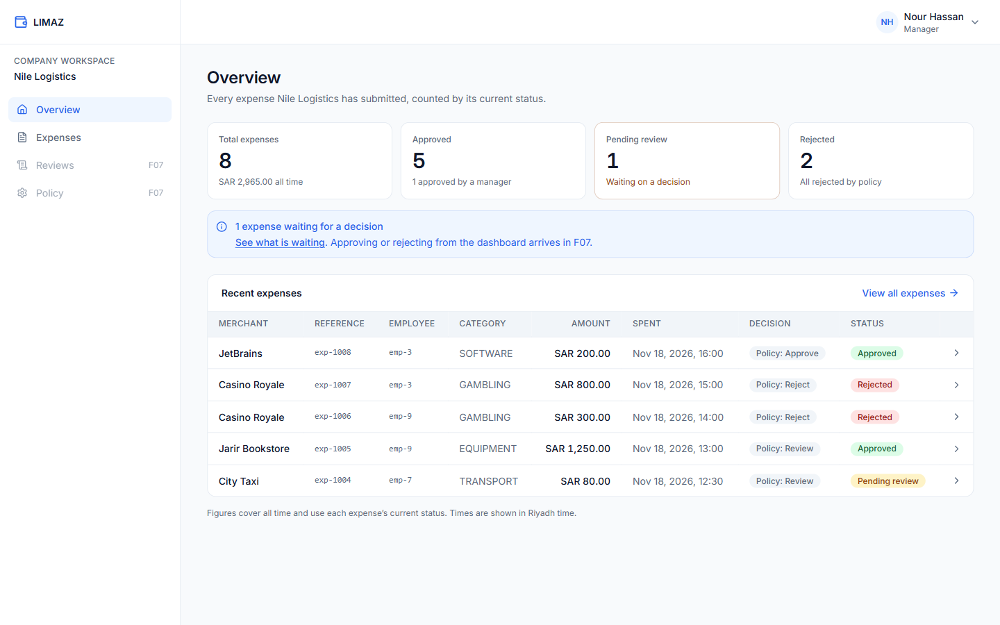 |
| Expense detail, with every reason and the policy snapshot | 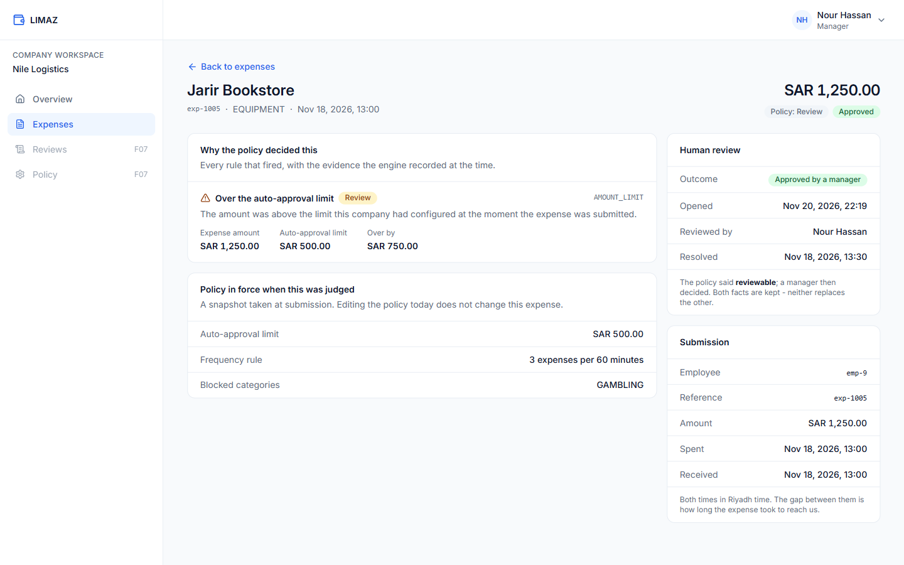 |
| Review queue | 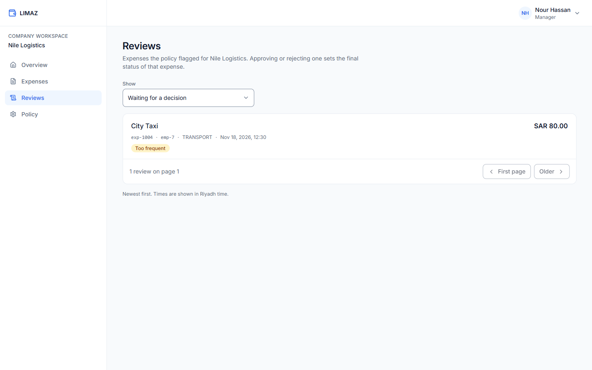 |
| Review detail, with the decision behind a confirmation | 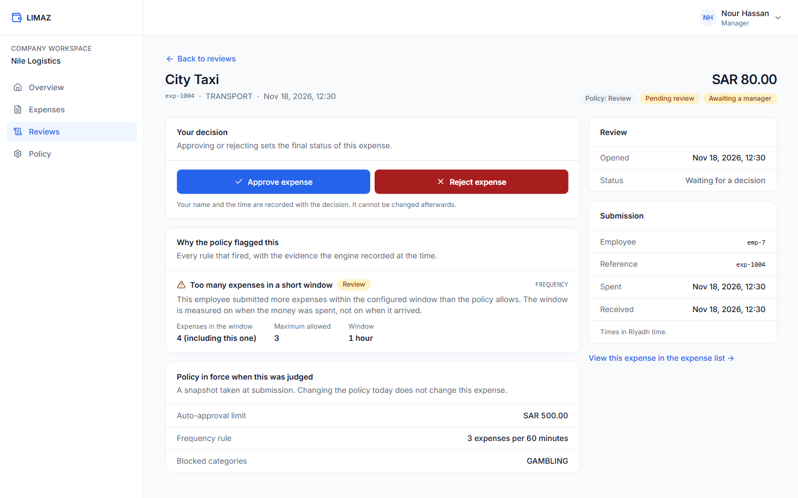 |
| Policy settings | 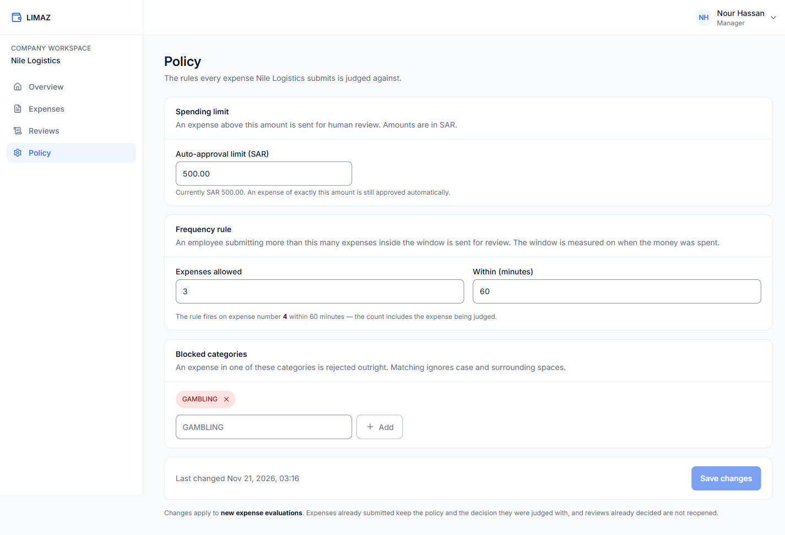 |
| Admin: companies | 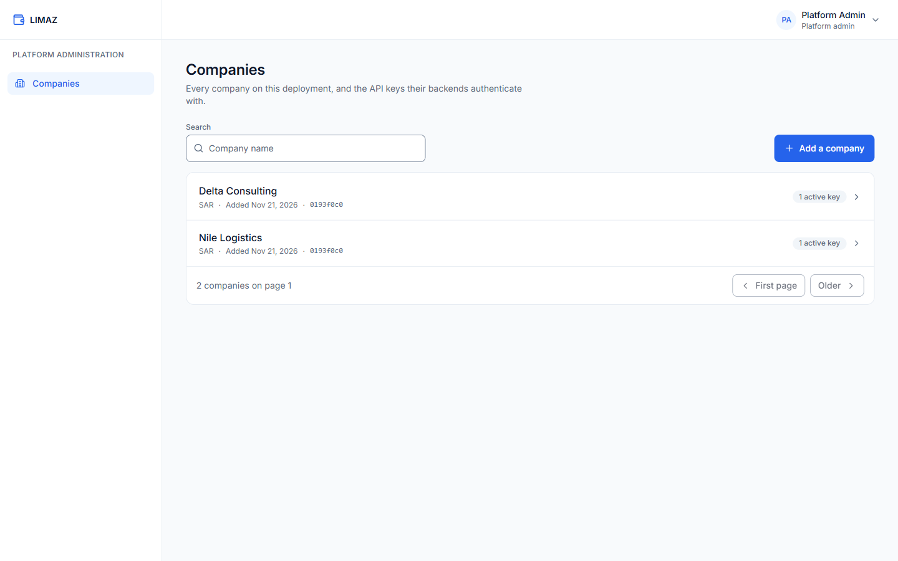 |
| Admin: a company's keys | 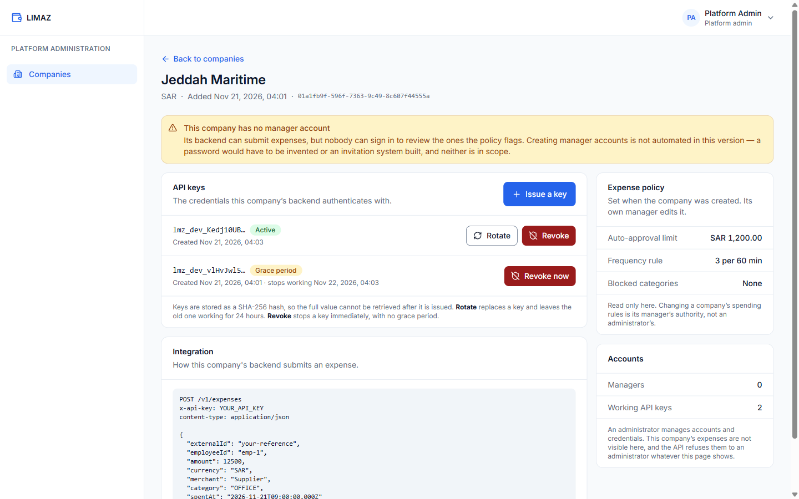 |
| Manager at 360px | 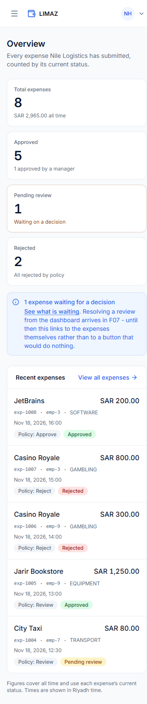 |
| Admin at 390px | 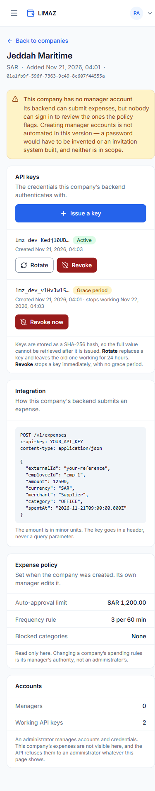 |

More - empty, loading and error states, the mobile drawer, the cross-tenant
404 - are in [`docs/screenshots/`](docs/screenshots/). The API-key dialog is
captured with the field masked **in the image**; AI_LOG 43 is the entry about
why that distinction matters.

---

## Repository map

```
apps/
  api/                    NestJS, a modular monolith
    src/config/           Zod environment validation - the only reader of process.env
    src/auth/             API key and session authentication, the three global guards
    src/expenses/         Submission, canonicalisation, idempotency, the policy engine
    src/reviews/          Review listing and resolution
    src/policy/           A company's own policy settings
    src/dashboard/        The single aggregate query
    src/admin/            Companies and the API key lifecycle
    prisma/               Schema, migrations, the idempotent seed
    test/                 487 tests against real PostgreSQL
  web/                    Next.js App Router
    app/api/[...path]/    The same-origin proxy
    app/(app)/dashboard/  Overview, expenses, reviews, policy
    app/(app)/admin/      Companies and keys
docs/
  adr/                    Eleven architecture decision records
  architecture/           Overview, data model, submission, policy, review lifecycle, frontend
  features/               One document per implementation feature, F00 to F08
  testing/                Test matrices with actual results, manual cycles, the safe order
  security/               The endpoint authorization matrix
  interview/              Five defence questions per feature
  risks.md                34 risks, each with the evidence behind its status
  requirements-traceability.md   Every assessment requirement mapped to evidence
scripts/                  Acceptance scripts and the contrast checker
AI_LOG.md                 Tools, prompts, and 50 recorded defects
```

### Build history

Each feature was implemented, tested and reviewed before the next began.

| Feature | Scope | Result |
|---|---|---|
| F00 | Monorepo, Docker, health check, config validation | 18/18 acceptance |
| F01 | Schema, migrations, idempotent seed | 11/11 acceptance |
| F02 | API key auth, sessions, tenant isolation, CSRF | 16/16 acceptance, 62 tests |
| F02.1 | Design tokens, primitives, app shell, login | 18/18 scripted |
| F03 | Submission, canonicalisation, idempotency | 130 tests |
| F04 | Policy rules, precedence, frequency concurrency | 63 tests |
| F05 | Review lifecycle and resolution | 66 tests |
| F06 | Dashboard, listing, filtering, expense detail | 67 tests |
| F07 | Review resolution UI and policy settings | 31 tests |
| F08 | Platform administration and the key lifecycle | 42 tests |
| **F09** | Integration, security hardening, regression | **5 defects found and fixed** |
| **F10** | Documentation and submission readiness | this README |

---

## AI usage

Everything in this repository was written with Claude Code, and everything in
it is mine to defend. [`AI_LOG.md`](AI_LOG.md) records the tools, the shape of
the prompts, and **50 defects** - each with how it was noticed, what fixed it,
and what stops it coming back. They include a floating-point bug I asserted in
a test that does not actually happen, an advisory lock that hid the very
mechanism its tests claimed to prove, a layout that leaked an admin heading
into a manager's RSC payload, and a live API key I wrote into a screenshot
during my own verification.

---

## Further reading

| | |
|---|---|
| [`docs/requirements-traceability.md`](docs/requirements-traceability.md) | every assessment requirement → implementation → evidence → status |
| [`docs/risks.md`](docs/risks.md) | 34 risks, each with the evidence behind its status |
| [`docs/adr/`](docs/adr/) | the eleven decisions, with the alternatives rejected |
| [`docs/security/endpoint-authorization.md`](docs/security/endpoint-authorization.md) | every route, every caller, measured |
| [`docs/testing/`](docs/testing/) | per-feature matrices with actual results, and manual cycles |
| [`docs/architecture/`](docs/architecture/) | overview, data model, submission, policy, review lifecycle, frontend |
| [`docs/self-review.md`](docs/self-review.md) | this repository read the way a reviewer would, scored against a stated rubric |
| [`docs/submission.md`](docs/submission.md) | the section 11 checklist, and the submission email |
| [`AI_LOG.md`](AI_LOG.md) | AI usage and every defect found |
