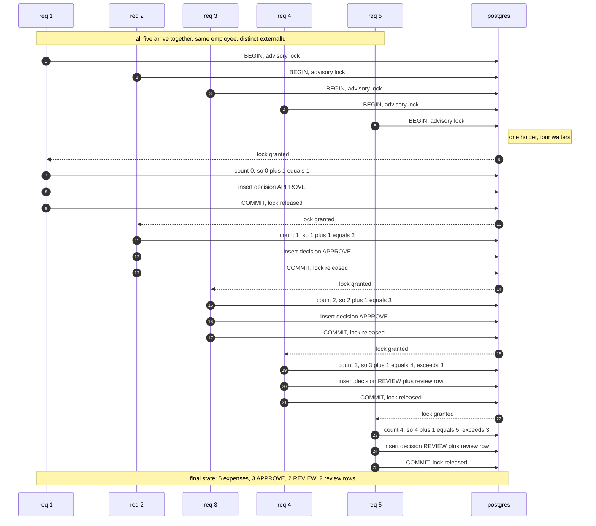

# ADR-007: Where the frequency count lives, and how it survives concurrency

- **Status:** Accepted, 2026-11-19
- **Assessment question:** 7
- **Implemented in:** F03 (idempotency), F04 (frequency)
- **Related risks:** R-02, R-03, R-09, R-10

## Context

Two different guarantees are routinely confused in this problem. Separating them
is the whole point of this record.

| | Guarantee 1: idempotency | Guarantee 2: frequency correctness |
|---|---|---|
| Invariant shape | **Uniqueness** - no two rows share a key | **Read-then-write** - read a count, decide, write |
| Mechanism | `UNIQUE (companyId, externalId)` plus conflict handling | **Serialisation** per `(companyId, employeeId)` |
| Needs a lock? | **No** | **Yes** |
| Does the database enforce it alone? | **Yes** | **No** |

**The unique constraint does not protect the frequency rule.** Consider two
concurrent submissions for the same employee with *different* `externalId`
values. The unique constraint is satisfied - both rows are legal. But both
transactions read `count = 3`, both conclude the rule does not fire, and the
window ends up holding five expenses with no REVIEW raised. Different problem,
different tool.

## Decision

The count is computed by a `COUNT(*)` over the index
`(company_id, employee_id, spent_at)`, inside the same transaction as the
insert, protected by a PostgreSQL **transaction-scoped advisory lock** keyed on
the company and employee.

## Advisory lock key derivation

```sql
SELECT pg_advisory_xact_lock(hashtext($companyId), hashtext($employeeId));
```

| Option | Key space | Verdict |
|---|---|---|
| `pg_advisory_xact_lock(hashtext(c || ':' || e))` | 2^32 | Rejected. At roughly 77,000 distinct keys there is a ~50% chance of at least one collision (birthday bound). Also ambiguous without a separator that cannot occur in `employeeId`. |
| **`pg_advisory_xact_lock(hashtext(c), hashtext(e))`** | **2^64** | **Chosen.** Two independent 32-bit arguments, no concatenation, no separator problem. |
| First 8 bytes of `sha256(c || 0x00 || e)` as `bigint` | 2^64 | Viable, but computes in the application for no additional safety. |

### Collisions are a performance concern, not a correctness one, risk R-09

If two unrelated `(company, employee)` pairs hash to the same lock, they wait on
each other unnecessarily. **No incorrect decision can result.** Every query
inside the lock still filters by the real `company_id` and `employee_id`; the
lock determines *who waits*, never *who sees what*.

The risk register records R-09 as **accepted** with that reasoning.

## Why `pg_advisory_xact_lock` and not the session variant

| | `pg_advisory_xact_lock` | `pg_advisory_lock` |
|---|---|---|
| Released | Automatically at `COMMIT` or `ROLLBACK` | Only by an explicit `pg_advisory_unlock` |
| If the process crashes mid-transaction | Released | **Held** |
| With connection pooling | Safe | A leaked lock poisons a pooled connection permanently |

We use pooling, and PgBouncer in any cloud deployment. The session variant would
be a latent outage.

## Isolation level: `READ COMMITTED`

`SERIALIZABLE` is not used. The advisory lock already provides mutual exclusion
on the only contended invariant; `SERIALIZABLE` would add `40001`
serialisation failures across every transaction and force retry handling
everywhere, for no additional guarantee here.

### `REPEATABLE READ` would silently break this design

This is the subtle part.

Under `READ COMMITTED`, **each statement takes a fresh snapshot**. We acquire
the lock first; the `COUNT(*)` that follows therefore takes its snapshot *after*
the lock is granted, and sees every competitor that has already committed.

Under `REPEATABLE READ`, the snapshot is taken at the **first statement of the
transaction** - which is the lock acquisition itself. The transaction then
blocks. When it is finally granted the lock, its snapshot is stale: the
competitor's committed row is invisible, and the count is wrong.

The code would look correct, the lock would genuinely be held, and the answer
would still be wrong. Raising the isolation level here makes the system less
correct, not more.

## Exact operation order

```
1.  BEGIN                                    -- READ COMMITTED
2.  SELECT pg_advisory_xact_lock(hashtext(companyId), hashtext(employeeId))
3.  SELECT ... FROM expenses
      WHERE company_id = $c AND external_id = $x        -- idempotency check
         -> found, same payloadHash      -> 200 with original decision, ROLLBACK
         -> found, different payloadHash -> 409,                      ROLLBACK
4.  SELECT * FROM policies WHERE company_id = $c
5.  SELECT count(*) FROM expenses
      WHERE company_id = $c AND employee_id = $e
        AND spent_at BETWEEN $t - interval '60 minutes' AND $t        -- N
6.  evaluatePolicy(expense, policy, N + 1) -> { decision, reasons[] } -- pure
7.  INSERT INTO expenses (...)               -- UNIQUE is the final authority
8.  INSERT INTO rule_hits (...)
9.  IF decision = 'REVIEW' THEN INSERT INTO reviews (...)
10. COMMIT                                   -- advisory lock released here
```

### Why this order, and what the alternatives cost

**Idempotency check inside the lock (step 3) rather than before it.**
A pre-lock read would let retries return without ever contending for the lock,
and retries are the common case under a retry storm. It also costs an extra
round trip and requires the check to be repeated inside anyway. We start with
the simpler single-transaction form and record the pre-lock fast path as the
first optimisation to reach for if contention is ever measured. The `UNIQUE`
constraint remains the final authority either way.

**Count before insert (step 5 before step 7) rather than after.**
Counting first yields `N`, we evaluate with `N + 1`, and write one row with its
decision already set. Inserting first would require counting, then a second
`UPDATE` on the same row to attach the decision, plus a window in which a row
exists with no decision.

**Policy load (step 4) is inside the lock but does not need to be.**
It is protected by nothing and changes nothing. Moving it before the lock would
shorten the critical section. Recorded as the second optimisation; not done now
because it splits the transaction's reads across two scopes for a gain we have
not measured.

### Lock contention is proportional to what it protects

The lock is per `(company, employee)`. Different employees never block each
other; different companies never block each other. The only contention is the
same employee submitting in parallel - which is exactly the case that must be
serialised.

## Behaviour under five simultaneous submissions

With `frequencyMaxCount = 3` and five concurrent requests for one employee, all
within one window:



The numbering above is illustrative. **Which request acquires the lock first is
not determined**, so the test below asserts counts, not identities.

## The concurrency test, F04-T07

```ts
const results = await Promise.all(
  [1, 2, 3, 4, 5].map((i) =>
    request(app)
      .post('/v1/expenses')
      .set('x-api-key', companyAKey)
      .send({
        externalId: `race-${i}`,
        employeeId: 'emp-concurrency',
        amount: 1000,
        currency: 'SAR',
        merchant: 'Test',
        category: 'TRANSPORT',
        spentAt: FIXED_TIMESTAMP,
      }),
  ),
);
```

Assertions, all order-independent:

| # | Assertion |
|---|---|
| 1 | Exactly 5 expenses exist for the employee |
| 2 | Exactly 3 have `decision = APPROVE` |
| 3 | Exactly 2 have `decision = REVIEW` |
| 4 | Exactly 2 review rows exist |
| 5 | Exactly 2 `FREQUENCY` rule hits are recorded |
| 6 | All five responses are `201` - no deadlock, no timeout |

Asserting `results[3].decision === 'REVIEW'` would be **flaky**, because lock
acquisition order is not deterministic. The test asserts properties of the final
state, not identities.

### Two conditions without which the test proves nothing

1. **`DB_POOL_MAX` must exceed the concurrency, risk R-10.** With a pool of one,
   the five requests queue inside the pool and execute sequentially. The test
   then passes without the advisory lock having done anything. The test
   environment pins `DB_POOL_MAX=10`.
2. **`spentAt` must be identical for all five**, so they are provably in one
   window.

### Negative control

The same test runs with the lock disabled via `FREQUENCY_LOCK_DISABLED=true`,
and **must fail** - typically producing five APPROVEs.

A test that passes with and without the mechanism it claims to verify is not a
test. The negative control is part of the suite, not an afterthought.

## Behaviour at 1,000 expenses per second

The advisory lock is per employee, so it is not the first bottleneck; the
transaction throughput of a single PostgreSQL instance is. In order:

1. **Connection pooling** in front of PostgreSQL (PgBouncer in transaction mode,
   which is compatible with `pg_advisory_xact_lock` precisely because the lock
   is transaction-scoped).
2. **Partition `expenses`** by month. The frequency query only ever touches the
   most recent partition, so the index stays small and hot.
3. **Move the counter out of PostgreSQL** - a Redis sorted set per
   `(company, employee)` acting as a sliding window, with PostgreSQL remaining
   the source of truth. This trades exactness for throughput and needs an
   explicit decision about what happens when Redis is unavailable.

**None of this is being built now.** Step 3 in particular replaces a guarantee
with an approximation, and that is only worth doing against a measured problem.

## Failure modes

| Failure | Effect | Mitigation |
|---|---|---|
| Lock acquired after the count | Count snapshot predates competitors | Lock is statement 2, before any read |
| `REPEATABLE READ` used | Stale snapshot, wrong count, no error | Isolation level asserted in an integration test |
| Session-scoped lock used | Leaked lock poisons a pooled connection | `pg_advisory_xact_lock` only; reviewed in code review |
| Pool smaller than test concurrency | Concurrency tests pass vacuously | `DB_POOL_MAX` validated at boot; negative control in the suite |
| Count filtered by decision | Rejected expenses stop counting | Assumption A2: the count includes all decisions |
