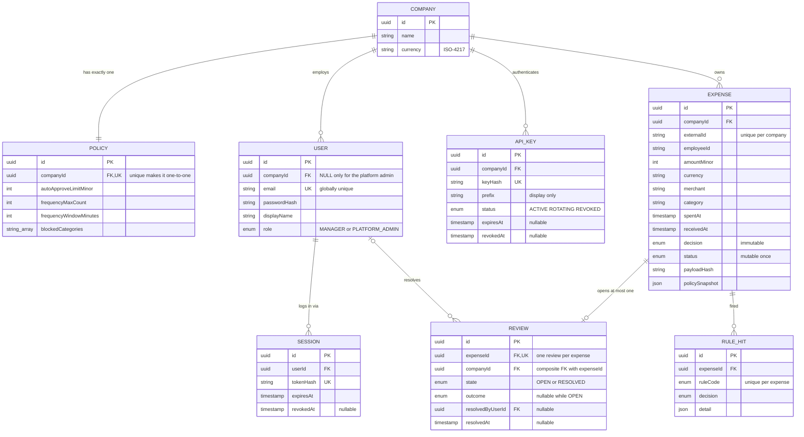

# Data model

Eight tables. Every constraint below exists because something concrete breaks
without it; where that is not obvious, the reason is stated.

## Entity relationship diagram



## Relationships

| Relationship | Cardinality | How it is enforced |
|---|---|---|
| Company to Policy | one to one | `UNIQUE` on `policies.companyId` |
| Company to User | one to many, optional on the child | `users.companyId` is nullable - the platform admin belongs to no company |
| Company to ApiKey | one to many | plain foreign key |
| Company to Expense | one to many | plain foreign key |
| User to Session | one to many | plain foreign key |
| User to Review (as resolver) | zero-or-one to many | `resolvedByUserId` is null while the review is open |
| Expense to RuleHit | one to many | `UNIQUE (expenseId, ruleCode)` - a rule fires at most once |
| Expense to Review | one to zero-or-one | `UNIQUE` on `reviews.expenseId` |
| **Review to its tenant** | **composite** | `FK (expenseId, companyId)` to `expenses(id, companyId)` - see ADR-011 |

## Constraints that carry a guarantee

| Constraint | Table | Protects |
|---|---|---|
| `UNIQUE (companyId, externalId)` | expenses | Tenant-scoped idempotency (ADR-001, risk R-03) |
| `UNIQUE (id, companyId)` | expenses | Referenceable key for the composite foreign key (ADR-011) |
| `FK (expenseId, companyId)` | reviews | **A review's tenant cannot diverge from its expense's** (ADR-011) |
| `UNIQUE (expenseId)` | reviews | One review per expense |
| `UNIQUE (expenseId, ruleCode)` | rule_hits | A rule fires at most once per expense |
| `UNIQUE (keyHash)` | api_keys | Indexed credential lookup (ADR-006) |
| `UNIQUE (tokenHash)` | sessions | Indexed session lookup (ADR-008) |
| `UNIQUE (email)` | users | Login by email alone must be decidable |
| `UNIQUE (companyId)` | policies | One policy per company |

### CHECK constraints

Prisma cannot express these, so they are appended by hand to the init
migration. They are load-bearing: each makes a forbidden state **unstorable**
from any writer, not merely discouraged in application code.

```sql
-- A MANAGER must belong to a company; the PLATFORM_ADMIN must not.
-- A MANAGER with a null companyId would make every tenant filter read
-- `WHERE company_id = NULL`, which matches nothing - or, in carelessly
-- written code, is dropped and matches everything.
users_role_company_check

-- A decision other than REVIEW is final the moment it is made: no review is
-- opened, so no manager can change it.
expenses_decision_status_check

-- Money is stored in minor units and cannot be negative.
expenses_amount_non_negative_check

-- A review is either fully open or fully resolved, never half of each.
-- The assessment requires a record of who resolved each review, when and how;
-- this makes a resolved review with no recorded reviewer unstorable.
reviews_state_resolution_check

-- autoApproveLimitMinor >= 0, frequencyMaxCount >= 1, window >= 1.
policies_sane_values_check
```

## Indexes

| Index | Query it serves |
|---|---|
| `(companyId, employeeId, spentAt)` on expenses | The frequency rule. **Column order is load-bearing**: the range column must come last for this to be a range scan rather than a filter (ADR-007) |
| `(companyId, spentAt)` on expenses | The manager dashboard. The index above cannot serve it, because `employeeId` sits between the two columns this query uses |
| `(companyId, state)` on reviews | The manager's open-review queue |
| `(companyId)` on api_keys | Listing a company's keys in the admin panel |
| `(companyId)` on users | Listing a company's managers |
| `(userId)` on sessions | Revoking every session for one user |

## Deletion behaviour

The principle: **records that are part of their parent and meaningless alone
cascade; records that are independent facts with audit value restrict.**

| Relationship | Behaviour | Why |
|---|---|---|
| Company to Policy | `CASCADE` | A policy without a company has no meaning |
| Company to ApiKey | `CASCADE` | A credential without a company has no meaning |
| Expense to RuleHit | `CASCADE` | Part of the expense |
| User to Session | `CASCADE` | Sessions die with their owner |
| Company to User | `RESTRICT` | A user is a person, not a detail of a company |
| Company to Expense | **`RESTRICT`** | **Financial records never disappear as a side effect** |
| Expense to Review | `RESTRICT` | A record of a human decision |
| Review to resolving User | `RESTRICT` | Deleting the reviewer would erase the audit trail |

The effect is that a company with expenses **cannot be deleted at all**. That
is intentional: the product has no company-deletion feature, and `RESTRICT`
turns that from an intention into a rule the database enforces. Deactivation,
not deletion, is the right answer for a departing manager.

## Types

| Choice | Reason |
|---|---|
| `uuid(7)` primary keys | Time-ordered, so inserts land at the end of the B-tree instead of scattering across it. Matters most on `expenses`, the highest-insert table |
| `Int` minor units for money | Floating point loses money; integers stay exact in both PostgreSQL and JavaScript (ADR-005) |
| `timestamptz(3)` | Every instant stored with a zone. Millisecond precision matches what JavaScript `Date` can represent, so values round-trip unchanged |
| `text[]` for `blockedCategories` | Short, read whole, never queried from the other direction. A join table would add a model for no gain |
| `Json` for `policySnapshot` | Makes each decision self-explaining without a policy-version table and without a join on every read (assumption A7) |
| `String` for `category` | The category vocabulary belongs to the company, not to us. An enum would need a migration for every new category. Normalised to uppercase so blocked-list matching is exact |

## What breaks if this changes

| Change | What breaks | Detected by |
|---|---|---|
| Remove `UNIQUE (companyId, externalId)` | Idempotency dies. A retry creates a second expense and counts twice toward frequency. An application-level `if exists` is not a substitute: under concurrency both requests pass the check | F01-T04 |
| Remove `companyId` from a tenant-owned table | Tenant isolation dies. Worse, the queries keep "working" and return other companies' rows | F02 suite, risk R-01 |
| Reorder the frequency index to `(employeeId, companyId, spentAt)` | Still functional but worse: the leading column of a B-tree decides what it can serve, and no query filters by `employeeId` alone | Performance measurement, not a test |
| Drop `spentAt` from the frequency index | The frequency query becomes a filter after a scan instead of a range scan - inside a transaction holding an advisory lock | ADR-007 |
| Make `reviews.expenseId` non-unique | One expense, several reviews, each resolved separately; the last write wins the status | F01-T06 |
| Remove the composite foreign key | `reviews.companyId` can diverge from its expense, and the tenant guard in ADR-004 reads the corrupted value | F01-T09, plus the executed negative control in ADR-011 |
| Merge `decision` and `status` into one field | "What did the policy originally conclude?" becomes permanently unanswerable. A manager approving a flagged expense would erase the fact that it was ever flagged | No test can catch this - which is exactly why it is a schema decision |
