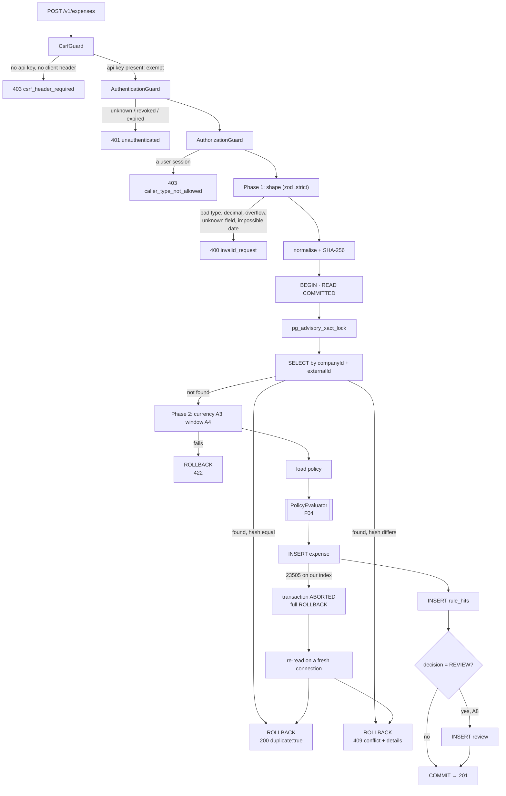
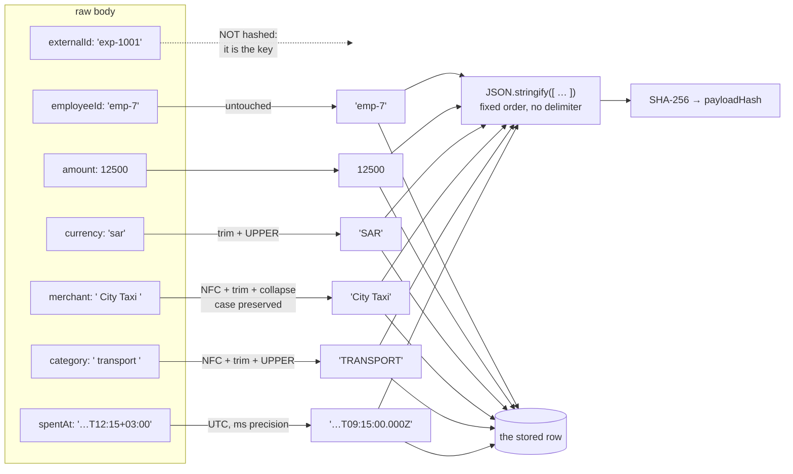
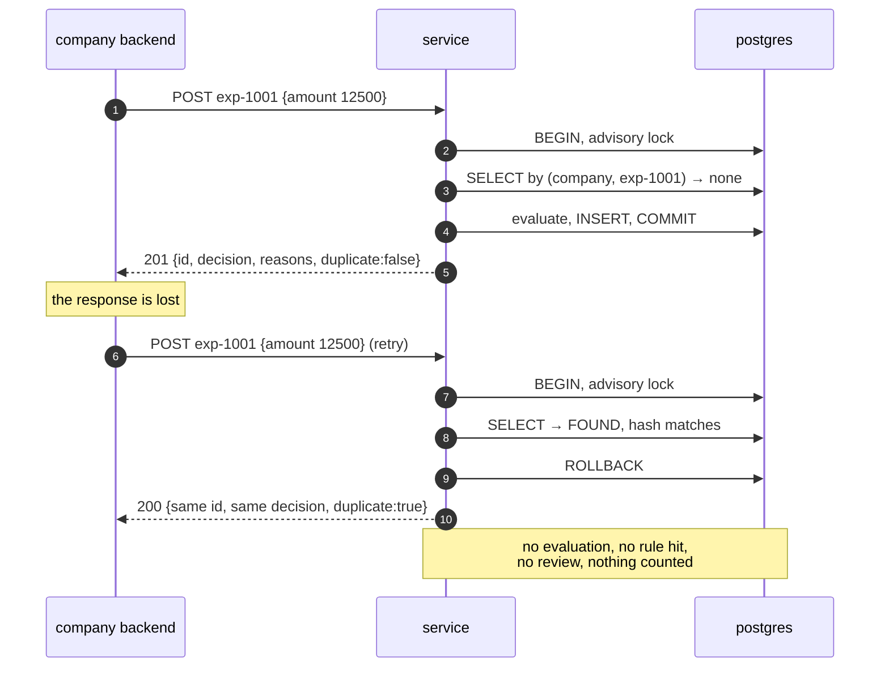
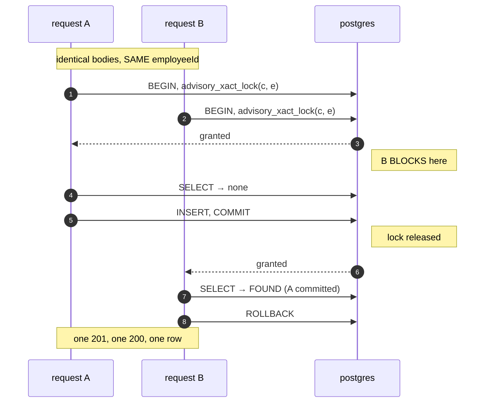
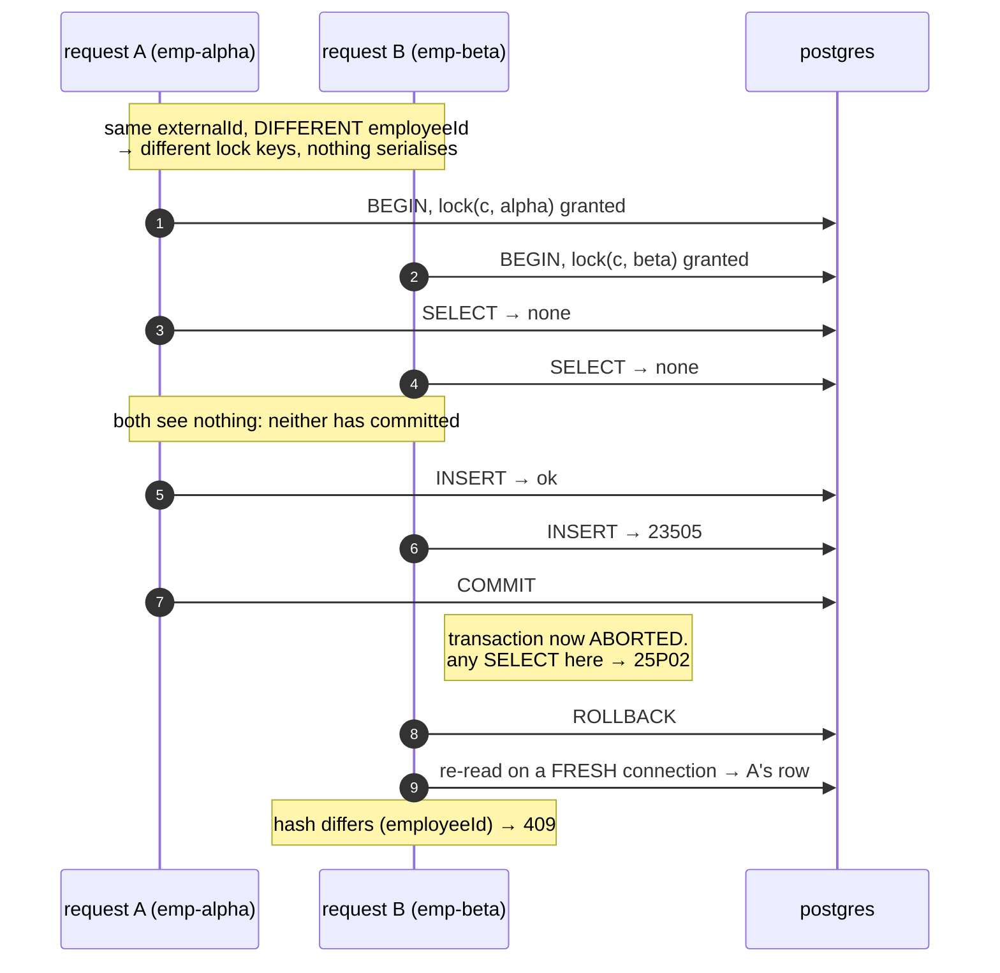
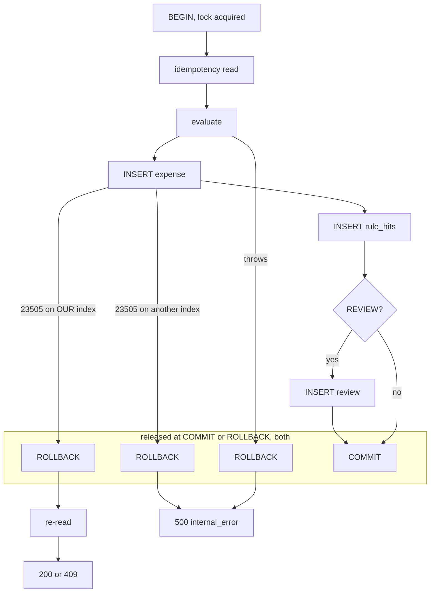
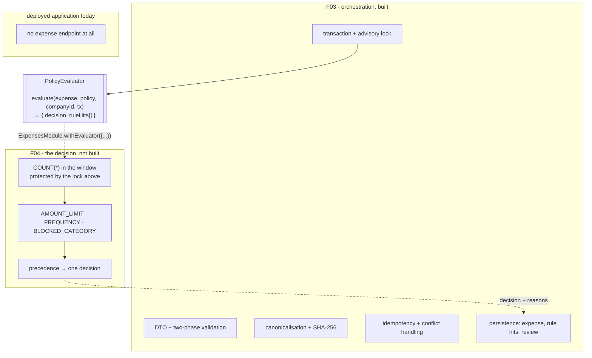

# Expense submission - the seven views

Diagrams for F03. Each one answers a question that is hard to answer in prose.

---

## 1. The submission lifecycle

**Guards before parsing.** An unauthenticated caller never reaches the DTO, so
validation messages cannot be used to probe the schema.

**Hash before the transaction.** Canonicalisation is pure and needs no
database, so it happens before a connection is held.

---

## 2. Normalisation and hashing

**The same normalised values feed both the hash and the row.** If they
diverged, a retry of a stored expense could hash differently from the expense
it is a retry of.

`employeeId` is untouched because normalising an identifier merges identities.
`merchant` and `category` are content, so normalising them removes differences
that carry no business meaning.

---

## 3. Sequential retry

The server cannot tell a lost response from an ordinary retry, and does not
try. There is no "was the response delivered?" state, and there should not be.

---

## 4. Concurrent duplicates

**The lock decides here, not the unique index.** B never attempts an INSERT,
so the index is never consulted. Which request wins is not determined, so
F03-T17 and F03-T18 assert the multiset of outcomes, never identities.

---

## 5. Conflicting payloads, and where the index actually fires

This is the only shape in which the unique index decides, which is why
**F03-T21** exists and why the negative control uses it. A suite testing only
diagram 4 passes with the index dropped.

---

## 6. Rollback and recovery

Three properties this shows:

1. **The advisory lock releases on either path**, because it is
   transaction-scoped. A session-scoped lock would survive a rollback and
   poison a pooled connection permanently (F03-T22b).
2. **A failure before the commit leaves nothing**, including the identifier -
   it is free to be submitted again (F03-T22).
3. **The 23505 branches split on WHICH index fired.** Treating any unique
   violation as an idempotency conflict would tell a caller their expense
   already existed when it was never written, and they would stop retrying
   (F03-T24).

---

## 7. The F03 / F04 boundary

`ExpensesModule` exposes **only** `withEvaluator()`, so wiring it requires
naming an evaluator. In F03 the sole caller is the test factory.

**Why not a stub returning APPROVE:** an endpoint that approves without
evaluating the frequency rule is not incomplete, it is wrong - and wrong in
the direction that approves spending the policy says to review. The
`expenses_decision_status_check` constraint would also refuse to store a
placeholder, so the shortcut was never available.

**What F04 changes:** one line in `app.module.ts` and one interface
implementation. No migration, no backfill, and no row has ever carried a
decision that was not genuinely evaluated.
