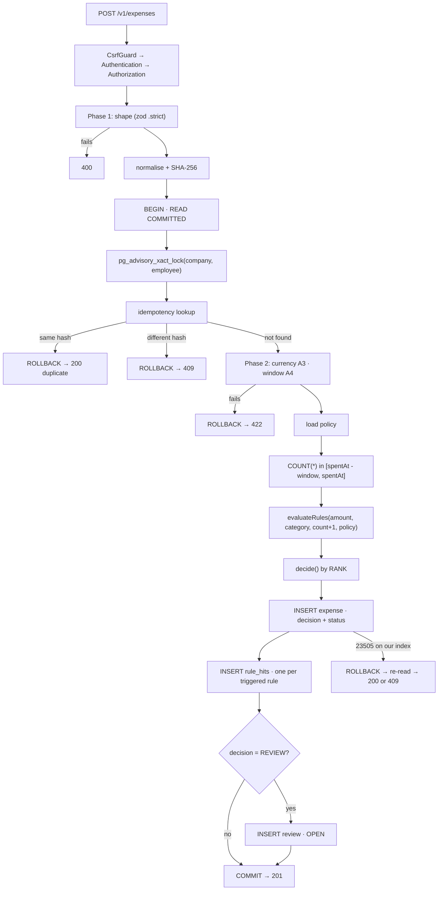
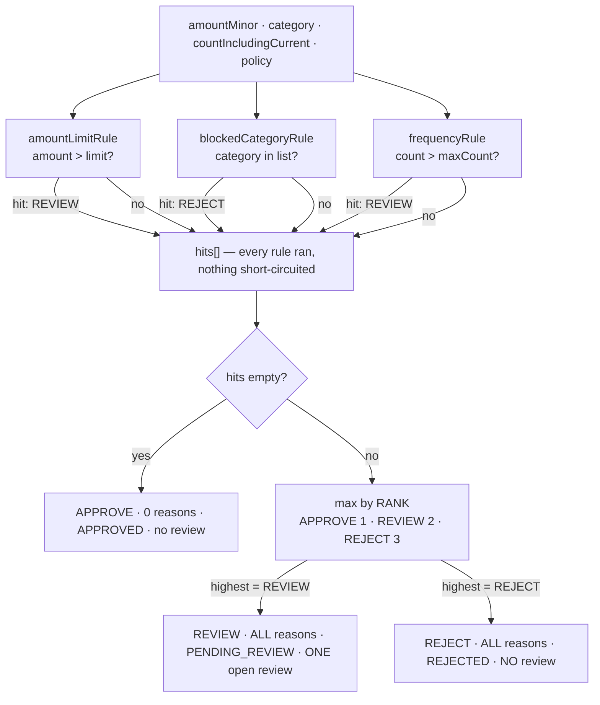
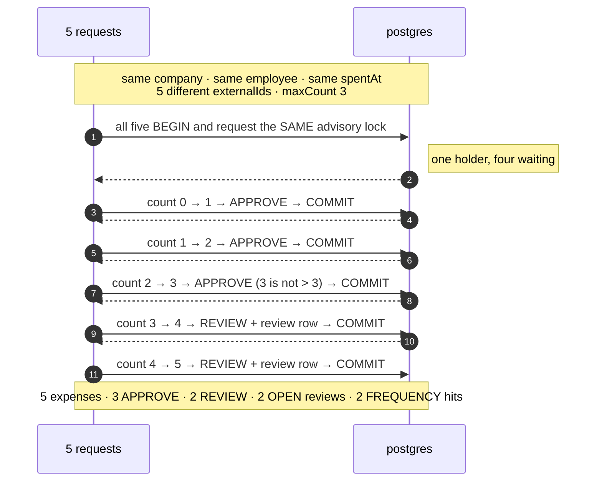
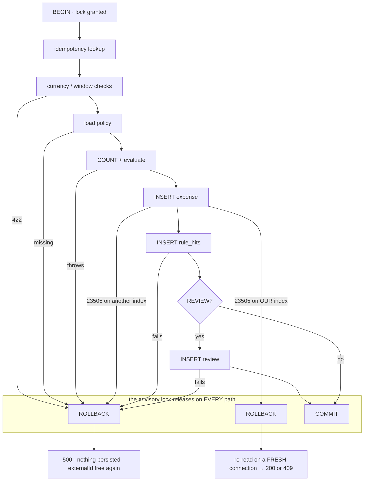
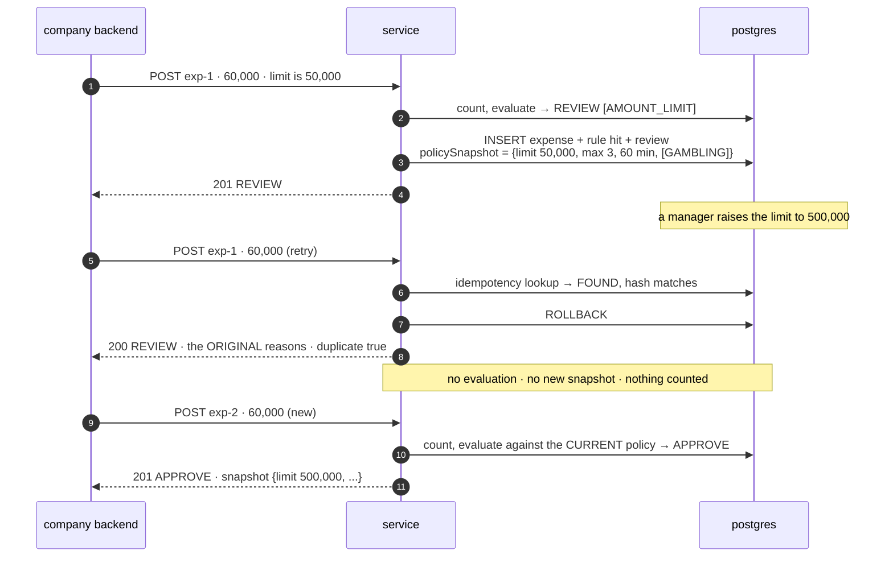

# Policy evaluation - the five views

Diagrams for F04. Each answers a question that is hard to answer in prose.

---

## 1. The complete submission lifecycle

**The lock is the first statement**, so the COUNT that follows snapshots after
it is held. **The evaluation is inside the transaction**, so the decision and
the row it describes commit together - and the `expenses_decision_status_check`
constraint would reject a row whose status did not match its decision anyway.

---

## 2. Evaluation and precedence

**Nothing short-circuits.** When the blocked-category rule fires the outcome is
already settled, and the other two still run - because the decision carries
one piece of information and the evaluation carries three. A manager reading
the expense later needs all three.

**Precedence is a rank table, not the order the lines appear in.** Reordering
the three calls provably cannot change the answer, which is what F04-T15
asserts over all six permutations.

**Two REVIEW rules still open one review.** The review belongs to the expense,
not to the rule.

---

## 3. Five concurrent submissions, one employee

The numbering is illustrative: **which request acquires the lock first is not
determined**, so F04-T26 asserts the multiset of outcomes and never an
identity.

The recorded `countIncludingCurrent` values are **4 and 5**, which is only
reachable if the transactions saw one another in order. Remove the lock and
all five count zero - that is F04-NC1, and it is why this diagram is evidence
rather than illustration.

---

## 4. Rollback

Three properties:

1. **The lock releases on commit and on rollback alike**, because it is
   transaction-scoped. A session-scoped lock would survive a failed
   transaction and poison a pooled connection permanently (F04-T32).
2. **Nothing partial survives.** The expense, its rule hits and its review are
   one transaction, so a failure at any step leaves no trace - including the
   identifier, which is free to submit again (F04-T37).
3. **The 23505 branches split on which index fired.** Treating any unique
   violation as an idempotency conflict would tell a caller their expense
   already existed when it was never written.

---

## 5. A retry after the policy changed

A retry is a **replay of a fact**, not a new evaluation. Re-evaluating would
change a decision already reported to the caller, and the review opened against
it would stop matching the expense it describes.

A new expense is a **new fact**, judged by whatever policy is current. The
snapshot recorded on each expense *is* the version - which is why no policy
versioning system is needed.

Tests F04-T40, T41, T42.
