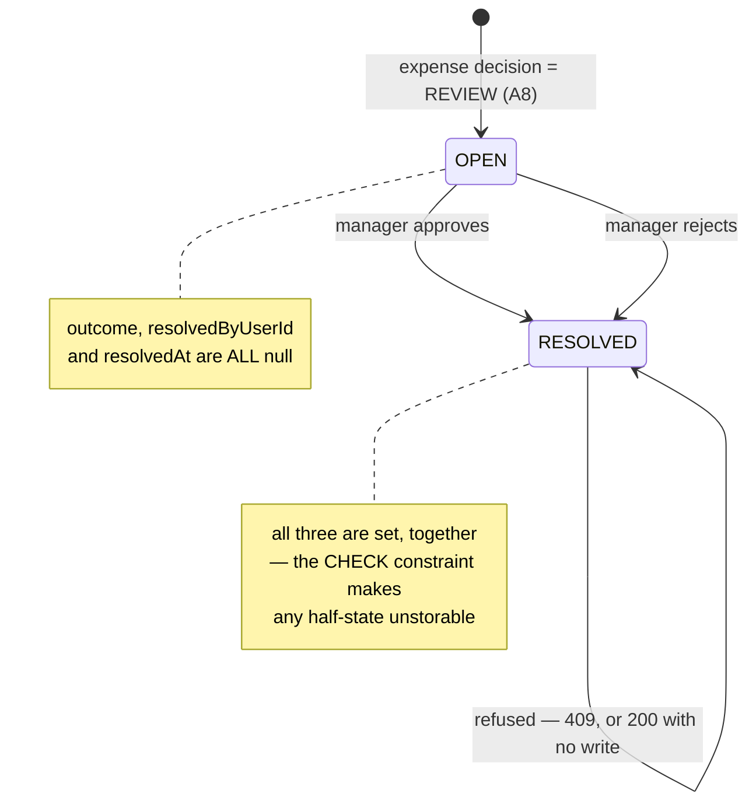
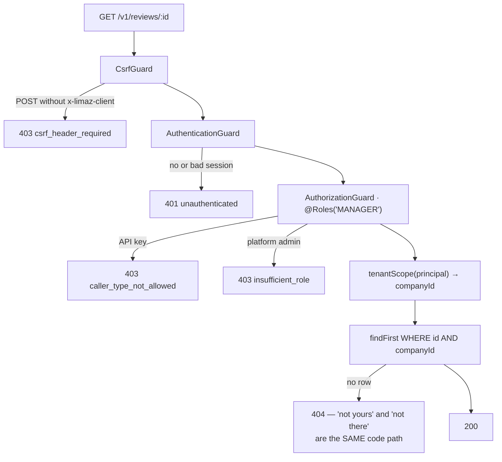
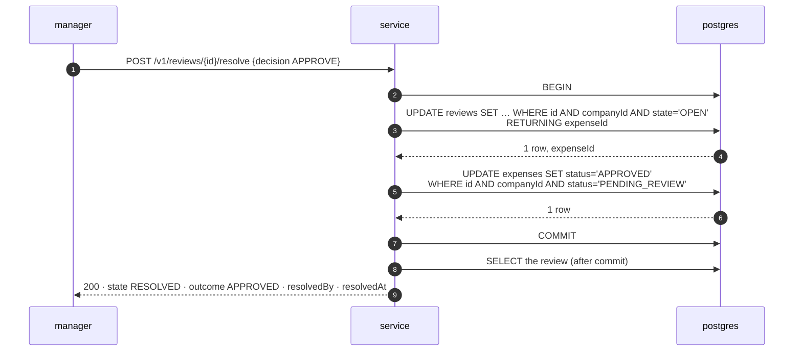
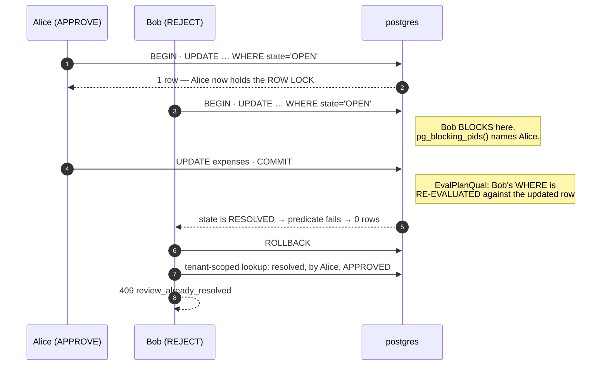
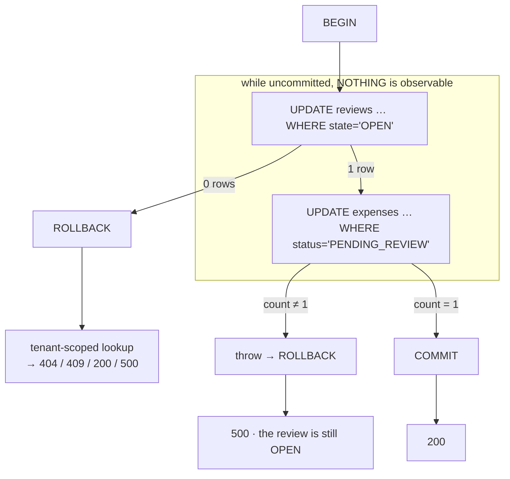
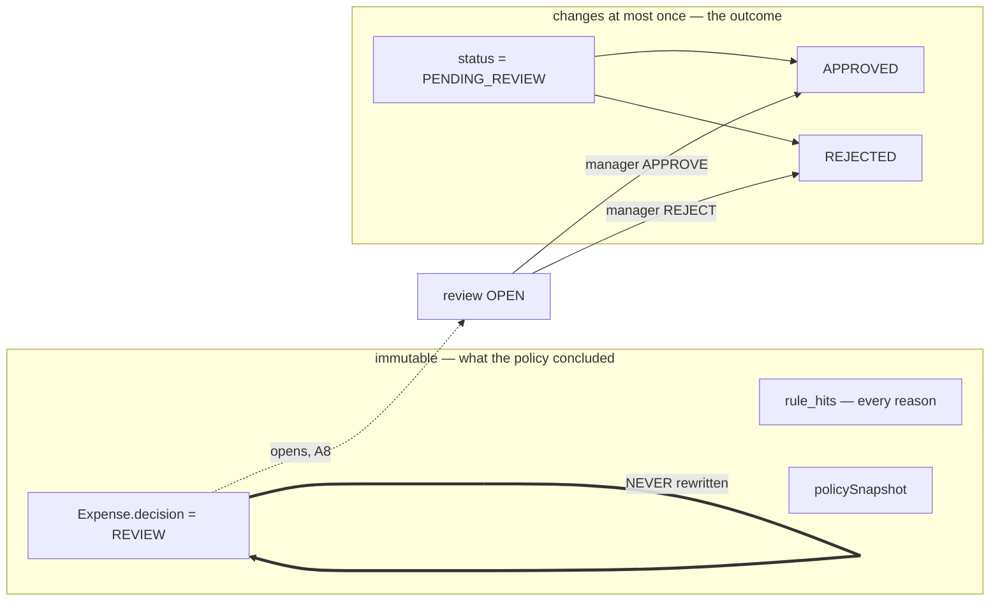
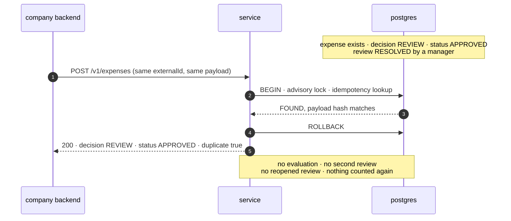

# Review lifecycle - the seven views

Diagrams for F05.

---

## 1. The state machine

There is no transition out of `RESOLVED`. Review reopening is out of scope,
and the CHECK constraint would have to be rethought to allow it.

---

## 2. Authentication and tenant-scoped access

The tenant predicate is **in the query**, not a check after fetching a global
row. A post-fetch check has already read another tenant's data into the
process, and is one refactor away from returning it.

404 rather than 403 for a foreign row: 403 confirms the row exists, which
would let a caller walk ids and learn how many reviews a competitor has
(ADR-003).

---

## 3. A successful resolution

The reviewer comes from the session and the timestamp from
`clock_timestamp()` inside the UPDATE. Neither can be supplied by the caller -
the DTO refuses any such field.

The final read happens **after** COMMIT, so the response describes committed
state and never a view that could still roll back.

---

## 4. Two managers competing

**The re-evaluation is the whole mechanism.** An in-memory check before an
unconditional UPDATE skips it entirely, and Bob's write lands on top of
Alice's - silently.

Which manager wins is **not determined**, so the tests assert the multiset of
outcomes and never an identity.

---

## 5. Rollback after a partial mutation

This is the answer to "what if the review update succeeds and the expense
update fails?" - **nothing is observable**. Neither write is visible to any
other transaction until COMMIT, so there is no moment at which the review is
resolved while its expense is still pending. That state exists only if the
two writes are split across separate transactions or separate HTTP calls.

F05-T39 forces it: the expense is moved out of `PENDING_REVIEW` behind the
service's back, the expense update matches zero rows, and the review is
asserted to be **still OPEN** afterwards.

---

## 6. The policy decision versus the final status

Merging the two fields would lose the answer to "what did the policy
originally say?", which is a basic audit question. A manager approving an
expense does not mean the policy was wrong to flag it.

---

## 7. Resubmission after a human resolution

The F03 response already carried both fields, which is why no correction was
needed: `decision` is the immutable policy conclusion, `status` the current
outcome.

The resolved expense still **counts** toward the frequency window - otherwise
approving an expense would quietly give the employee their window back
(F05-T30b).
