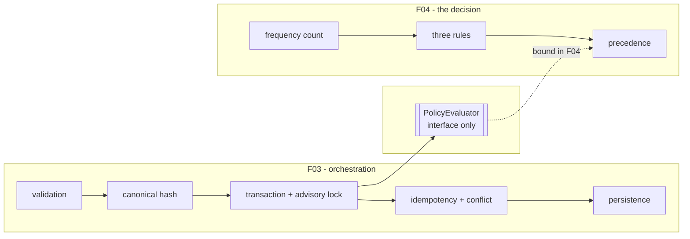

# F03 - Expense submission and idempotency

**Status:** Implemented, awaiting project-owner approval
**Date:** 2026-11-20
**Depends on:** F00, F01, F02
**Blocks:** F04, F05, F06

## Objective

A company's backend submits an expense. The same logical expense can never be
created twice, however many times the request arrives and however the requests
overlap. Retries create no duplicate expense, no duplicate rule hit, no
duplicate review, and nothing extra in a future frequency window.

## Scope

### In scope

- `POST /v1/expenses`, API-key authenticated, tenant derived from the key
- Two-phase validation: shape (400) and business (422)
- Deterministic payload canonicalisation and SHA-256 hashing
- Tenant-scoped idempotency enforced by the database
- The full submission transaction, including the advisory lock F04 needs
- Correct handling of an aborted PostgreSQL transaction
- Database-error classification precise enough to be safe
- One sanitised `details` field on the error body, for the 409

### Out of scope, deliberately

The policy engine and the frequency count (F04), review resolution (F05), any
UI (F06-F08). **No production expense endpoint exists yet** - see the
integration boundary below.

---

## No migration

F01 already provided everything: `@@unique([companyId, externalId])`,
`payloadHash`, `policySnapshot`, and the `(companyId, employeeId, spentAt)`
index F04 will count over.

One F01 decision turned out to shape this feature more than expected:

```sql
ALTER TABLE "expenses" ADD CONSTRAINT "expenses_decision_status_check"
  CHECK ((decision = 'APPROVE' AND status = 'APPROVED') OR ...);
```

**A placeholder decision is physically unstorable.** That closed off the
tempting shortcut - write the expense now with `APPROVE`, fix it in F04 -
before it could be proposed, and it is why the integration boundary below is
a seam rather than a temporary state.

---

## The governing rule: identifiers are compared exactly, content is normalised

Normalising an identifier **merges identities**.

If ` exp-1` were trimmed to `exp-1`, a caller submitting the first would
receive the decision belonging to the second, silently, with nothing in the
response to indicate a substitution had happened. The same applies to case
folding (`exp-1` / `EXP-1`) and to Unicode normalisation.

| Field | Treatment | Why |
|---|---|---|
| `externalId` | **Untouched.** Untrimmed or control-bearing values are **rejected (400)** | A loud error the caller can fix beats a silent merge they cannot see |
| `employeeId` | **Untouched**, same rejection | `emp-7` and `EMP-7` may be two people, and merging them attributes one person's spending to another |
| `currency` | `trim` + uppercase | ISO-4217 codes are case-insensitive by convention |
| `merchant` | NFC + `trim` + collapse whitespace runs. **Case preserved** | Renaming a merchant is a real change; respacing is not |
| `category` | NFC + `trim` + collapse + uppercase | The schema stores it uppercase so F04's blocked-list match is exact |
| `spentAt` | UTC, millisecond precision | The column is `Timestamptz(3)` |

### The normalised values are what gets stored

Not just what gets hashed. Hashing one value and persisting another is how a
genuine retry ends up conflicting with the row it is a retry of: the column
would truncate a timestamp to milliseconds while the hash covered the
microseconds that were dropped.

---

## Canonicalisation

```ts
JSON.stringify([employeeId, amountMinor, currency, merchant, category, spentAtIso])
```

**An array, not an object.** Key ordering is not a problem that is solved
here - it is a question the structure makes impossible to ask.

**No hand-rolled delimiter.** Joining with `|` collides: merchant `a|b` with
category `C` produces the same string as merchant `a` with category `b|C`.
JSON escapes quotes inside each value, so no value can impersonate a field
boundary. Test: *"no value can impersonate a field boundary"*.

**No canonicalisation library.** RFC 8785 (JCS) solves arbitrary JSON: nested
key ordering, number formatting edge cases, Unicode collation. With six fields
of known types that is a dependency paying for a problem we do not have.

### Unicode

`merchant` and `category` are NFC-normalised. `é` written as one code point
and as `e` + combining acute are visually identical and bytewise different;
without NFC they would be a spurious 409 that no caller could diagnose.

Identifiers are deliberately **not** NFC-normalised, by the rule above.

## The canonicalisation compatibility contract

**This is a contract, not an implementation detail.** Every expense already
stored carries a hash computed under the rules in force when it arrived, and
those hashes are compared against newly computed ones forever. A change here
does not take effect going forward - it **retroactively invalidates every
stored hash**, so a correct retry of an existing expense would produce a
different hash, be read as a conflicting resubmission, and be refused with a
`409` the caller has no way to resolve.

### Contract version 1 - frozen 2026-11-20

```
canonical = JSON.stringify([
  employeeId,      // exactly as submitted
  amountMinor,     // integer
  currency,        // trim, uppercase
  merchant,        // NFC, trim, collapse whitespace runs, case preserved
  category,        // NFC, trim, collapse whitespace runs, uppercase
  spentAtIso,      // UTC, YYYY-MM-DDTHH:mm:ss.sssZ
])

payloadHash = sha256(canonical) as lowercase hex
```

Covered: those six fields, in that order.
Excluded: `externalId` and `companyId` (identity, not payload), `receivedAt`,
`id`, `decision`, `status`, `policySnapshot` (server-generated, and they
change between retries).

A reference value is pinned by an exact-match assertion, so the contract
cannot drift without someone editing a test on purpose:

```
["emp-7",12500,"SAR","City Taxi","TRANSPORT","2026-11-20T09:15:00.000Z"]
```

### What is a breaking change

| Change | Breaking? |
|---|---|
| Adding a field to the array | **Yes** - every stored hash becomes unreachable |
| Removing a field | **Yes**, and it also silently accepts a changed value as a retry |
| Reordering the array | **Yes** |
| Changing any normalisation rule | **Yes** |
| Changing the hash algorithm or encoding | **Yes** |
| Adding a column to `expenses` that is not hashed | No |
| Changing the response shape | No |

### How to change it safely, if it is ever necessary

Not by editing this function. Add a `payloadHashVersion` column, write new
expenses under version 2, and compare an existing expense using **the version
it was stored with**. That keeps old retries working while new ones get the
new rules.

That upgrade path is **not built** - it costs a column and a branch for a
change nobody has needed. It is written down here so the decision is made
deliberately rather than discovered after a release. Risk **R-26**.

---

## Validation in two phases, and why the order matters

| Phase | Checks | Status | Depends on |
|---|---|---|---|
| 1. Shape | types, lengths, integer amount, int4 range, ISO-8601 instant, real calendar date, unknown fields | **400** | nothing |
| 2. Business | currency is this company's (A3), `spentAt` inside the window (A4) | **422** | tenant and clock |

**The idempotency lookup runs between them.**

An expense accepted ninety-one days ago is still a legitimate thing to retry.
Phase 1 is time-independent by construction, so the retry parses; the lookup
then finds the row and returns the original decision. Running phase 2 first
would reject that retry with a 422 for a rule the original submission
satisfied, and the caller could never stop retrying. Test **F03-T25**; its
mirror **F03-T25b** shows the A4 rule still applies in full to anything new.

### A real gap this uncovered

`Date.parse('2026-02-30T09:15:00Z')` does not fail. February 2026 has 28 days,
so it rolls the surplus over and returns **2 March** - two days past the end
of the month.

The first version of the DTO accepted it, and the expense would have been
stored on a date the caller never wrote, in a different frequency window, with
nothing recording that a substitution had happened. The date is now checked
against the calendar fields in the string itself, not against the parsed
result.

There is no fixed "off by N days" to quote, because 30 February does not
exist and the rollover distance depends on the month and the year - 31 April
lands on 1 May, and 30 February in a leap year lands on 1 March. The defect is
that the stored date is not the submitted one.

It is checked against the string rather than the parsed UTC date because an
offset legitimately moves the UTC day: `2026-11-20T01:00:00+03:00` really is
19 November in UTC.

---

## The transaction

```
BEGIN                                      -- READ COMMITTED
  SELECT pg_advisory_xact_lock(hashtext($company), hashtext($employee))
  SELECT ... WHERE companyId = $c AND externalId = $x
     found + same hash  -> 200 with the original decision, ROLLBACK
     found + diff hash  -> 409,                            ROLLBACK
  assert currency (A3) and spentAt window (A4)             -> 422, ROLLBACK
  SELECT policy
  evaluate(expense, policy, tx)                            -- the F04 seam
  INSERT expenses                                          -- UNIQUE decides
  INSERT rule_hits
  INSERT reviews  (only when decision = REVIEW, A8)
COMMIT                                     -- the advisory lock releases here
```

### Why the lock is taken in F03, which does not need it

Idempotency is a **uniqueness** invariant, and the database enforces it alone.
The frequency rule is a **read-then-write**, which no constraint can protect
(ADR-007). The lock exists for the second.

It is taken now because the lock has to be the **first statement** for the
count that follows to see every competitor that has already committed - under
`READ COMMITTED` each statement takes a fresh snapshot, so a lock acquired
later would protect a count that was already stale. Building that order once
is safer than reordering the transaction in F04 underneath tests that have
already passed.

**F03-T28 asserts the separation directly**: two requests taking *different*
lock keys, so the lock serialises nothing between them, still cannot produce
two rows.

### The consequence nobody expects: the lock hides the constraint

The lock is keyed on `(companyId, employeeId)`.

| Shape | What happens | Which mechanism decides |
|---|---|---|
| Same `employeeId` | They serialise. The second finds the first's committed row at the idempotency step and returns 200 | **The lock.** The constraint never fires |
| Different `employeeId` | Different lock keys, so the transactions run side by side and both reach the INSERT | **The constraint** |

A suite testing only the first shape **would pass with the constraint
dropped**. That is why **F03-T21** exists, and why the negative control uses
that shape rather than the obvious one.

---

## The aborted transaction

When the INSERT raises `23505`, PostgreSQL puts the transaction into an
aborted state. Every statement after that - including a plain `SELECT` -
fails with:

```
25P02  current transaction is aborted, commands ignored until end of transaction block
```

So the winning row **cannot** be read inside the same transaction. Catching
the conflict and querying there produces a second, more confusing error, and
is the usual reason this path ends as a 500.

| Option | Verdict |
|---|---|
| `SAVEPOINT` before the INSERT, `ROLLBACK TO` on conflict | Works. Costs raw savepoint SQL inside a Prisma interactive transaction, for a path that is rare by construction |
| **Full rollback, then re-read on a fresh connection** | **Chosen.** One indexed lookup on a unique key |
| `INSERT ... ON CONFLICT DO NOTHING RETURNING` | Avoids the abort, but still needs a second read and breaks the typed API for the rule-hit and review inserts |

The winner cannot have vanished in between: this service never deletes
expenses, and `Company.onDelete: Restrict` prevents a company from being
removed while it still has any. If it is somehow missing, that is an explicit
500 rather than a quiet success.

### `onDelete: Restrict` is not a deletion guard

Worth stating plainly, because it is easy to read it as one. `Restrict`
prevents deleting a **company** that still has expenses. It says nothing about
deleting an expense directly - a `DELETE FROM expenses`, a Prisma
`expense.delete()`, or a future retention job would all succeed, and
`rule_hits` would cascade away with it.

**Expense deletion is outside our supported operations.** Nothing in the
application performs one, and no endpoint exposes one. If retention or erasure
is ever required it needs its own design, because deleting an expense frees
its `externalId` and a later retry of it would create a *new* expense with a
fresh decision. Risk **R-27**.

---

## Classifying the database error

Prisma reports every unique violation as `P2002`. The question that matters is
not "did a unique constraint fire?" but "did
`expenses_companyId_externalId_key` fire?"

Getting that wrong in the permissive direction is the dangerous case: a
`rule_hits_expenseId_ruleCode_key` violation reported as an idempotency
conflict would tell the caller their expense already existed. They would stop
retrying, and the expense would simply be lost.

So the classifier reads the real SQLSTATE and the index name from
`meta.driverAdapterError.cause` - the same path the F01 constraint tests use -
and requires the constraint name before claiming a conflict. Anything it
cannot positively identify falls through to a 500. Tests **F03-T24** and
**F03-T24b**.

---

## The F04 integration boundary



`ExpensesModule` has **no default export and no plain `@Module` to import**.
The only way in is:

```ts
ExpensesModule.withEvaluator({ useClass: PolicyEngineEvaluator })
```

which forces whoever wires it to name an evaluator. In F03 the only caller is
the test factory, so **the deployed application has no expense endpoint at
all**.

### Why not a stub that returns APPROVE

An endpoint that answers APPROVE without evaluating the frequency rule is not
incomplete - it is **wrong**, and wrong in the direction that approves
spending the policy says to review. The CHECK constraint would also refuse to
store a placeholder, so the shortcut was never available.

### What F04 changes

One line in `app.module.ts`, and an implementation of one interface. No
migration, no backfill, and no row has ever carried a decision that was not
genuinely evaluated.

---

## The error body gained one optional field

```ts
{ statusCode, error, message, details? }
```

`details` is **opt-in**: an exception that does not set it produces a body
byte-for-byte identical to before (regression tests F03-T30 to F03-T32).

What may appear inside is restricted by **type, not by field name**: strings
(redacted), numbers, booleans, and one level of nested plain object.
Everything else - an `Error`, a Prisma payload, a `Date`, an array of objects,
a class instance - is dropped without comment. A thrower therefore cannot
attach something carrying a `payloadHash` or a `keyHash` by accident, and
naming what was removed would itself describe the internal shape.

The 409 uses it to name the conflicting field and the decision already issued,
which ADR-001 requires. The stored hash is never published: it would let a
caller brute-force the payload of an expense they cannot otherwise read, one
guess at a time (**F03-T14c**).

---

## Files

```
apps/api/src/expenses/
  canonical-payload.ts          normalisation + SHA-256
  dto/submit-expense.dto.ts     shape validation, zod .strict()
  policy-evaluator.port.ts      the F03/F04 seam
  idempotency-conflict.ts       database error classification
  expense-submission.service.ts the transaction
  expenses.controller.ts        POST /v1/expenses
  expense.types.ts              the public response shape
  expenses.module.ts            withEvaluator() only

apps/api/src/common/http-exception.filter.ts   + sanitised `details`

apps/api/test/expenses/
  canonical-payload.spec.ts           unit
  submission-validation.e2e-spec.ts   validation, auth, tenant
  idempotency.e2e-spec.ts             sequential retry and conflict
  concurrency.e2e-spec.ts             real races with a bounded barrier
  negative-control.e2e-spec.ts        destructive, isolated database only
  filter-regression.e2e-spec.ts       the unchanged error bodies
  expenses-test-app.ts
  test-policy-evaluator.ts
```

## Known limits

- **No production endpoint until F04.** Deliberate; see above.
- **`amountMinor` is `int4`**, so a single expense cannot exceed 21,474,836.47
  of a two-decimal currency. Accepted rather than changed. Risk **R-25**.
- **Zero-decimal and three-decimal currencies are not modelled.** `amountMinor`
  is minor units of whatever the company's currency is, and nothing records
  how many decimals that currency has. Fine while every company is SAR.
- **Expense deletion is unsupported**, and the schema does not prevent it.
  Risk **R-27**.
- **The canonicalisation is a contract**, and the repository holds no
  versioning for it. Risk **R-26**.

---

## Change impact analysis

What each decision is actually load-bearing for. Severity is the consequence
if the change were made, not the likelihood of anyone making it.

| Change | Affected | Consequence | Severity | Caught by |
|---|---|---|---|---|
| **Remove the unique index** | `expenses` | Concurrent submissions create duplicate expenses. Worse: once duplicates exist the index **cannot be rebuilt** (`23505 could not create unique index`), so recovery needs data deletion, not a migration | **Critical** | F03-T27 |
| **Key on `externalId` without `companyId`** | idempotency, tenancy | Company A's `INV-001` blocks company B's. A cross-tenant denial of service, and an oracle revealing which identifiers A has used. Sequential ids are common in the systems that call this | **Critical** | F03-T20, F03-T20b |
| **Remove the payload hash** | ADR-001 | Every repeat becomes a retry. A caller correcting an amount is told it was accepted while the original stands. The error is silent and permanent | **High** | F03-T14, F03-T14b |
| **Hash the raw JSON** | canonicalisation | Spurious 409s on key order, on `sar` vs `SAR`, on `+03:00` vs `Z`. Clients retrying correctly are refused with no way to diagnose it | **High** | F03-T15, F03-T16, F03-T13d |
| **Normalise `externalId`** | identity | Two distinct caller records merge. One caller receives another's decision with nothing indicating a substitution | **High** | validation suite |
| **Floating-point money** | everything downstream | `0.1 + 0.2 ≠ 0.3`. Amounts drift, hashes stop matching, the limit comparison in F04 becomes approximate, and the error appears as money | **Critical** | F03-T05, ADR-005 |
| **Trust `companyId` from the body** | tenancy | Any key holder writes into any tenant. The single worst outcome in the system | **Critical** | F03-T12, F03-T12c |
| **Replace conflict handling with `upsert`** | ADR-001 | Last write wins: a decision already reported changes afterwards, and a review may be open against an amount that no longer exists | **High** | F03-T14 (asserts the stored amount) |
| **Re-evaluate on every retry** | A7, F04 frequency | A retry counts toward a future frequency window, and a decision changes when the policy changes. Both break the promise that one identity maps to one outcome | **High** | F03-T13b, F03-T14d |
| **Query inside the aborted transaction** | the conflict path | `25P02`, surfacing as a 500 on the one path that must answer 200 or 409. Callers retry an expense that was already written | **High** | F03-T21, F03-T24 |
| **Move evaluation outside the transaction** | F04 | The count loses the advisory lock's protection and sees a different snapshot, so concurrent submissions under-count and the frequency rule silently stops firing. A window also opens in which an expense exists with no decision - which the CHECK constraint rejects, turning a logic error into a 500 | **Critical** | ADR-007; F04 must re-prove |
| **Treat any `P2002` as a conflict** | error classification | A rule-hit violation is reported as "already exists". The caller stops retrying and the expense is lost | **High** | F03-T24, F03-T24b |
| **Let `details` through on a 5xx** | the error filter | Internal shape - table and constraint names - reaches an unauthenticated caller | **Medium** | F03-T34b |
